# Mathematical roadmap

This is a map of every result reviewed in this repository, written for AI agents (GPT, Claude) and for people. Its machine-readable twin is [`roadmap.json`](roadmap.json). The tables and graphs between `GENERATED` markers are produced from that file by [`tools/check_roadmap.py`](tools/check_roadmap.py), which also validates it. Updated 29 October 2026.

## 0. Quick start for AI agents

**New here or after a context reset?** Read [`START_HERE.md`](START_HERE.md) first, then [`PROOF_MAP.md`](PROOF_MAP.md), which is this DAG as readable dependency-ordered paths with a proof sketch for every node. Verify everything with `python3 tools/verify_all.py` (about 3 minutes).

1. **One node per result.** Each result has a stable ID such as `ETH.II.LIFT` or `KAK.E.BAL`. The node records:
   - a precise statement (ASCII math) and a status;
   - the file and label where it is proved;
   - a **proof sketch** from the nodes it uses, and any alternative proofs;
   - the nodes its proof uses, and the scripts that check it;
   - its Lean name, if that exact statement is formally verified.
2. **Checking a claim.**
   - Open the node's `where` file at the given label.
   - Run its `checks` scripts. They are deterministic, print `ALL OK`, and write JSON to `results/`.
3. **Seeing what a result rests on.** Run `python3 tools/check_roadmap.py --node KAK.T12`. It prints the node, every node it transitively depends on, and its weakest prose link.
4. **Contributing.** Pick a target in §6 and follow the protocol in §7. Never renumber or rename a node.
5. **Standards.** See [`REVIEW_STANDARD.md`](REVIEW_STANDARD.md): definition → theorem → proof; narrowest verdicts; subjective confidences labelled as such.

**Reading orders.**

| Goal | ETH | Kakeya |
|---|---|---|
| Verdict in 5 minutes | [eth/01](reviews/claude/eth/01_VERDICT.md) | [kakeya/01](reviews/claude/kakeya/01_VERDICT.md) |
| Shortest complete proof | path *ETH is false* in [PROOF_MAP](PROOF_MAP.md#p-eth-i), full text [eth/08](reviews/claude/eth/08_GAPLESS_PROOF.md) | path *Shortest complete proof* in [PROOF_MAP](PROOF_MAP.md#p-kak-planar), full text [kakeya/13](reviews/claude/kakeya/13_PLANAR_ENTRY_POINT.md) |
| The distilled general proof | path *One deformation theorem* in [PROOF_MAP](PROOF_MAP.md#p-eth-unified), full text [eth/13](reviews/claude/eth/13_UNIFIED_DEFORMATION.md) | path *The distilled route* in [PROOF_MAP](PROOF_MAP.md#p-kak-engine), full text [kakeya/11](reviews/claude/kakeya/11_FRAMEWORK_POSITIVITY_ENGINE.md) |
| Why the method stops where it does | path *the design floor* in [PROOF_MAP](PROOF_MAP.md#p-eth-floor), full text [eth/14](reviews/claude/eth/14_DESIGN_FLOOR.md) and [eth/13](reviews/claude/eth/13_UNIFIED_DEFORMATION.md) §5 | path *Sharpness* in [PROOF_MAP](PROOF_MAP.md#p-kak-limits) |
| Everything the paper claims | eth/08 → [09](reviews/claude/eth/09_GAPLESS_SHARP_EXPONENT.md) → [10](reviews/claude/eth/10_GAPLESS_TENSOR_CONTRACTION.md) → [11](reviews/claude/eth/11_GAPLESS_COROLLARIES.md) | kakeya/08 → [09](reviews/claude/kakeya/09_GAPLESS_CONSEQUENCES.md) → [10](reviews/claude/kakeya/10_GAPLESS_REMAINING.md) |
| Reusable tools | [eth/07](reviews/claude/eth/07_TOOLKIT.md), [eth/12](reviews/claude/eth/12_FP_COUNTING.md) | [kakeya/07](reviews/claude/kakeya/07_TOOLKIT.md) |
| A guided reading at four levels | — | [kakeya/15](reviews/claude/kakeya/15_HOW_TO_READ_THE_PROOF.md) |
| Which equations the method handles | — | path *The reach of the engine* in [PROOF_MAP](PROOF_MAP.md#p-kak-scope), full text [kakeya/16](reviews/claude/kakeya/16_NULL_FRAME_AND_SCHRODINGER.md), [kakeya/17](reviews/claude/kakeya/17_STATE_DIMENSION_RIGIDITY.md) |
| Formal proofs | [eth/06](reviews/claude/eth/06_LEAN_STATEMENT_AUDIT.md) | [kakeya/06](reviews/claude/kakeya/06_LEAN_AUDIT.md) |

## 1. Status codes

| Code | Meaning |
|---|---|
| `FORMAL` | The exact statement is a theorem of OpenAI's Lean proof. That proof was built locally, uses only `propext`, `Classical.choice` and `Quot.sound`, and its elaborated statement was audited. Internal lemmas are never marked `FORMAL`; the optional field `lean_area` names the closest Lean module instead. |
| `PROVED` | A complete prose proof is in this repository. Textbook theorems (spectral theorem, Hoeffding, Riesz–Thorin, Mihlin, …) are cited by name. |
| `PROVED_CITED` | A complete prose proof, except for named non-elementary cited theorems whose hypotheses are checked (Evans–Krylov, Tao's ε-removal, Williams's algorithm, …). |
| `CHECKED` | Key identities, or the algorithm itself, are checked exactly by a script with negative controls. Finite checks confirm identities; they do not prove asymptotic claims. |
| `PARTIAL` | Exponents, new identities and the structure are checked. Some analytic estimates were followed but not rewritten line by line. |
| `HEURISTIC` | A blueprint, not yet a theorem. |
| `NEW` | Not in the source paper; proved here. |

The **prose chain** column gives the weakest prose link among a node and everything it depends on:
- `closed` means every link is `PROVED`;
- `cites X, Y` names the `PROVED_CITED` links.

The checker enforces that a node proved in prose depends only on nodes proved in prose.

<!-- BEGIN GENERATED: summary -->
| Project | Results | FORMAL | PROVED | PROVED_CITED | PARTIAL | HEURISTIC | NEW | CHECKED |
|---|---|---|---|---|---|---|---|---|
| ETH | 39 | 1 | 37 | 2 | 0 | 0 | 13 | 29 |
| KAK | 39 | 6 | 33 | 6 | 0 | 0 | 13 | 23 |

Targets: 13 open, 0 in progress, 7 done.
<!-- END GENERATED: summary -->

## 2. ETH: *The Exponential Time Hypothesis Is False*

**The question.** Is #$k$-SAT solvable in $2^{o(n)}$ time? Yes. There are three nested routes, and each is complete here.

| Route | Bound | Key idea | Where |
|---|---|---|---|
| I | $2^{O_k(n(\log\log n)^{k+1}/(\log n)^{1/(2k)})}$ | Deform the substitution $x\mapsto P(T)x$ so the count becomes a polynomial in $T$. At integer nodes the sum splits into independent groups. Recover $T=0$ by interpolation. | [eth/08](reviews/claude/eth/08_GAPLESS_PROOF.md) |
| II | $2^{O_k(n(\log\log n)^2/\sqrt{\log n})}$ (formally verified) | Reduce to sparse $\mathbb F_2$ systems with a Tanner code and greedy rows. Lift parity to $\mathbb Z/2^\ell$ at linear degree. Count with algebra coefficients. | [eth/09](reviews/claude/eth/09_GAPLESS_SHARP_EXPONENT.md) |
| III | $2^{O_k(n\log\log n/\sqrt{\log n})}$; $2^{O(n/\sqrt{\log n})}$ at fixed density | Contract a Boolean tensor network by a 2-adic Cauchy-kernel deformation, recursing on modes. | [eth/10](reviews/claude/eth/10_GAPLESS_TENSOR_CONTRACTION.md) |

All three routes share one deformation principle (`ETH.I.DEFCOUNT`): find a polynomial deformation that is local at many nodes, then pay its degree in interpolation. Route III replaces degree with 2-adic precision. Target `T.ETH.2` asks for a single theorem covering both.

### 2.1 Dependency graph

An arrow $A\to B$ means that the proof of $B$ uses $A$. Colours:
- green: formally verified statement;
- blue: proved;
- yellow: proved modulo a named cited theorem;
- orange: partially verified;
- purple dashed: heuristic.

```mermaid
flowchart TD
  subgraph ETH_g0["Part I: subexponential #35;k-SAT"]
    ETH_I_SPARS["ETH.I.SPARS<br/>Disjoint sparsification"]
    ETH_I_TOVEY["ETH.I.TOVEY<br/>OR gates and Tovey cycles"]
    ETH_I_DEFCOUNT["ETH.I.DEFCOUNT<br/>Deformation counting"]
    ETH_I_SWAP["ETH.I.SWAP<br/>Swap interpolation in closed form"]
    ETH_I_TRANSFER["ETH.I.TRANSFER<br/>Transfer to a formula; balanced schedules"]
    ETH_I_PARAM["ETH.I.PARAM<br/>Counting at #60;=3 occurrences, explicit parameters"]
    ETH_I_MAIN["ETH.I.MAIN<br/>ETH is false (Part I)"]
  end
  subgraph ETH_g1["Part II: the formally verified exponent rho(n)"]
    ETH_II_LIFT["ETH.II.LIFT<br/>Parity lift in closed form; cross-equation truncation"]
    ETH_II_ZEROS["ETH.II.ZEROS<br/>Counting common zeros of sparse F_2 systems"]
    ETH_II_TANNER["ETH.II.TANNER<br/>Initial tests from a Tanner code"]
    ETH_II_GREEDY["ETH.II.GREEDY<br/>Greedy rows by exact counts"]
    ETH_II_MAIN["ETH.II.MAIN<br/>#35;k-SAT in 2^O(rho(n)) (formally verified bound)"]
  end
  subgraph ETH_g2["Part III: App. D, tensor contraction"]
    ETH_III_RING["ETH.III.RING<br/>Coefficient ring and interpolation points"]
    ETH_III_CAUCHY["ETH.III.CAUCHY<br/>Cauchy kernel"]
    ETH_III_HERMITE["ETH.III.HERMITE<br/>Tapered 2-adic Hermite recovery"]
    ETH_III_PACK["ETH.III.PACK<br/>Packing edges into packets"]
    ETH_III_CHILD["ETH.III.CHILD<br/>Modes and the child identity"]
    ETH_III_TENSOR["ETH.III.TENSOR<br/>Boolean tensor contraction"]
    ETH_III_FIXED["ETH.III.FIXED<br/>Fixed clause density"]
    ETH_III_SPARSEZ["ETH.III.SPARSEZ<br/>Sparse systems by contraction"]
    ETH_III_MAIN["ETH.III.MAIN<br/>Headline Theorem 1.1"]
  end
  subgraph ETH_g3["Corollaries"]
    ETH_C_MAXSAT["ETH.C.MAXSAT<br/>Max-k-SAT approximation"]
    ETH_C_GRAPH["ETH.C.GRAPH<br/>Independent sets, colourings, perfect matchings"]
    ETH_C_CIRC1["ETH.C.CIRC1<br/>E^NP not in SIZE(O(n))"]
    ETH_C_CIRC2["ETH.C.CIRC2<br/>E^NP circuit lower bound c n sqrt(log n)"]
    ETH_C_LOCAL["ETH.C.LOCAL<br/>Inverting maps of constant output locality"]
  end
  subgraph ETH_g4["New results"]
    ETH_N_LIFTP["ETH.N.LIFTP<br/>p-adic lift for every prime (E2) with a closed form (new)"]
    ETH_N_FQ["ETH.N.FQ<br/>Counting zeros of sparse systems over any finite field (new) (new)"]
    ETH_K_E3["ETH.K.E3<br/>Exact partition functions of bounded-degree factor graphs (new)"]
    ETH_K_E4["ETH.K.E4<br/>Cost floor of the method (new)"]
  end
  subgraph ETH_g5["Unified deformation"]
    ETH_U_NODE["ETH.U.NODE<br/>Node lemma: filtered mode expansion (new)"]
    ETH_U_HERMITE["ETH.U.HERMITE<br/>Hermite recovery with valuation loss (new)"]
    ETH_U_COUNT["ETH.U.COUNT<br/>Correction counts, two-sided (new)"]
    ETH_U_MAIN["ETH.U.MAIN<br/>Interpolation through local nodes (the unified deformation theorem) (new)"]
    ETH_U_FLOOR3["ETH.U.FLOOR3<br/>Cost floor of the 2-adic architecture (new)"]
  end
  subgraph ETH_g6["Design floor"]
    ETH_D_NORMAL["ETH.D.NORMAL<br/>Normal form of group-algebra swap designs (new)"]
    ETH_D_SMOL["ETH.D.SMOL<br/>Parity under a biased measure (Smolensky + restriction) (new)"]
    ETH_D_FLOOR["ETH.D.FLOOR<br/>Design floor: every graded swap design pays (log log n)^2/sqrt(log n) (new)"]
    ETH_D_FACE["ETH.D.FACE<br/>Face lemma for arbitrary group-algebra designs (new)"]
  end
  ETH_U_MAIN -.->|alt| ETH_I_DEFCOUNT
  ETH_I_SWAP --> ETH_I_TRANSFER
  ETH_I_DEFCOUNT --> ETH_I_PARAM
  ETH_I_SWAP --> ETH_I_PARAM
  ETH_I_TRANSFER --> ETH_I_PARAM
  ETH_I_SPARS --> ETH_I_MAIN
  ETH_I_TOVEY --> ETH_I_MAIN
  ETH_I_PARAM --> ETH_I_MAIN
  ETH_I_DEFCOUNT --> ETH_II_ZEROS
  ETH_I_SWAP --> ETH_II_ZEROS
  ETH_I_TRANSFER --> ETH_II_ZEROS
  ETH_II_LIFT --> ETH_II_ZEROS
  ETH_II_TANNER --> ETH_II_GREEDY
  ETH_I_SPARS --> ETH_II_MAIN
  ETH_II_ZEROS --> ETH_II_MAIN
  ETH_II_TANNER --> ETH_II_MAIN
  ETH_II_GREEDY --> ETH_II_MAIN
  ETH_U_HERMITE -.->|alt| ETH_III_HERMITE
  ETH_III_CAUCHY --> ETH_III_CHILD
  ETH_III_PACK --> ETH_III_CHILD
  ETH_U_NODE -.->|alt| ETH_III_CHILD
  ETH_III_CAUCHY -.->|alt| ETH_III_CHILD
  ETH_III_PACK -.->|alt| ETH_III_CHILD
  ETH_III_RING --> ETH_III_TENSOR
  ETH_III_CAUCHY --> ETH_III_TENSOR
  ETH_III_HERMITE --> ETH_III_TENSOR
  ETH_III_PACK --> ETH_III_TENSOR
  ETH_III_CHILD --> ETH_III_TENSOR
  ETH_III_TENSOR --> ETH_III_FIXED
  ETH_III_TENSOR --> ETH_III_SPARSEZ
  ETH_II_LIFT --> ETH_III_SPARSEZ
  ETH_III_FIXED --> ETH_III_MAIN
  ETH_III_SPARSEZ --> ETH_III_MAIN
  ETH_I_SPARS --> ETH_III_MAIN
  ETH_II_TANNER --> ETH_III_MAIN
  ETH_II_GREEDY --> ETH_III_MAIN
  ETH_II_MAIN --> ETH_C_MAXSAT
  ETH_I_MAIN --> ETH_C_GRAPH
  ETH_II_MAIN --> ETH_C_CIRC1
  ETH_III_FIXED --> ETH_C_CIRC2
  ETH_II_MAIN --> ETH_C_LOCAL
  ETH_II_LIFT --> ETH_N_LIFTP
  ETH_N_LIFTP --> ETH_N_FQ
  ETH_II_ZEROS --> ETH_N_FQ
  ETH_I_DEFCOUNT --> ETH_N_FQ
  ETH_I_DEFCOUNT --> ETH_K_E3
  ETH_I_SWAP --> ETH_K_E3
  ETH_I_TRANSFER --> ETH_K_E3
  ETH_I_SWAP --> ETH_K_E4
  ETH_U_NODE --> ETH_U_MAIN
  ETH_U_HERMITE --> ETH_U_MAIN
  ETH_U_COUNT --> ETH_U_MAIN
  ETH_U_HERMITE --> ETH_U_FLOOR3
  ETH_U_COUNT --> ETH_U_FLOOR3
  ETH_I_SWAP --> ETH_D_NORMAL
  ETH_D_NORMAL --> ETH_D_FLOOR
  ETH_D_SMOL --> ETH_D_FLOOR
  ETH_K_E4 --> ETH_D_FLOOR
  ETH_I_SWAP --> ETH_D_FACE
  class ETH_II_MAIN formal
  class ETH_I_SPARS,ETH_I_TOVEY,ETH_I_DEFCOUNT,ETH_I_SWAP,ETH_I_TRANSFER,ETH_I_PARAM,ETH_I_MAIN,ETH_II_LIFT,ETH_II_ZEROS,ETH_II_TANNER,ETH_II_GREEDY,ETH_III_RING,ETH_III_CAUCHY,ETH_III_HERMITE,ETH_III_PACK,ETH_III_CHILD,ETH_III_TENSOR,ETH_III_FIXED,ETH_III_SPARSEZ,ETH_III_MAIN,ETH_C_MAXSAT,ETH_C_GRAPH,ETH_C_LOCAL,ETH_N_LIFTP,ETH_N_FQ,ETH_K_E3,ETH_K_E4,ETH_U_NODE,ETH_U_HERMITE,ETH_U_COUNT,ETH_U_MAIN,ETH_U_FLOOR3,ETH_D_NORMAL,ETH_D_SMOL,ETH_D_FLOOR,ETH_D_FACE proved
  class ETH_C_CIRC1,ETH_C_CIRC2 cited
  classDef formal fill:#c8e6c9,stroke:#2e7d32,color:#000
  classDef proved fill:#bbdefb,stroke:#1565c0,color:#000
  classDef cited fill:#fff9c4,stroke:#f9a825,color:#000
  classDef partial fill:#ffccbc,stroke:#d84315,color:#000
  classDef heuristic fill:#e1bee7,stroke:#6a1b9a,color:#000,stroke-dasharray:4 3
```

<!-- BEGIN GENERATED: eth-graph -->

<!-- END GENERATED: eth-graph -->

### 2.2 Results

<!-- BEGIN GENERATED: eth-nodes -->
| ID | Result | Status | Prose chain | Depends on | Where | Checks | Lean |
|---|---|---|---|---|---|---|---|
| `ETH.I.SPARS` | **Disjoint sparsification.** For 0&lt;sigma&lt;=1 a k-CNF on n variables is split by a branching tree into at most (C_M n+1)^2 2^{sigma n} normalized CNFs of width &lt;=k, whose satisfying sets partition Sat(F), each variable occurring in at most B=O_k((sigma^{-1}log(2/sigma))^{k-1}) clauses. | PROVED, CHECKED | closed | — | [eth/08](reviews/claude/eth/08_GAPLESS_PROOF.md) §2, Prop. 2.4, Lemma 2.5 | [verify_gapless_chain](reviews/claude/eth/scripts/verify_gapless_chain.py) | — |
| `ETH.I.TOVEY` | **OR gates and Tovey cycles.** A CNF of width &lt;=k with occurrence bound B gives, in polynomial time, a CNF L' of width &lt;=3 with every variable in 1..3 clauses and N&lt;=6kBn variables, and z with #L=2^z #L'. | PROVED, CHECKED | closed | — | [eth/08](reviews/claude/eth/08_GAPLESS_PROOF.md) §3, Prop. 3.3 | [verify_gapless_chain](reviews/claude/eth/scripts/verify_gapless_chain.py) | — |
| `ETH.I.DEFCOUNT` | **Deformation counting.** Given a deformation of degree &lt;=R' with Q&lt;p nodes whose rows are local for measured partitions, the sum over {0,1}^n of a product of factors (clauses, or any factors with values in a free Z/p^mu-algebra, degree measured in the algebra) is computed with Q\*C_q(n)\*(2beta+1)^{c_\*}\*2r\*2^s\*poly operations, q=floor(dR'/Q). | PROVED, CHECKED | closed | — | [eth/08](reviews/claude/eth/08_GAPLESS_PROOF.md) §4, Thm 4.6; [eth/09](reviews/claude/eth/09_GAPLESS_SHARP_EXPONENT.md) §1, Thm 1.1 (general factors) | [verify_gapless_chain](reviews/claude/eth/scripts/verify_gapless_chain.py), [verify_sharp_route](reviews/claude/eth/scripts/verify_sharp_route.py) | — |
| `ETH.I.SWAP` | **Swap interpolation in closed form.** P(T)=I-M_0+sum_k gamma_k sum_{\|S\|=k} prod_{s in S}(1-T/s) Pi_{S^c} has P(0)=I, degree &lt;=R-1, coefficients in Z[1/(2Q!)], and P(t) is local on ker C at every node t; c/D &lt;= 2exp(-R^2/(8Q)). | PROVED, CHECKED | closed | — | [eth/08](reviews/claude/eth/08_GAPLESS_PROOF.md) §5, Thm 5.4, Cor. 5.6; [eth/07](reviews/claude/eth/07_TOOLKIT.md) E1 | [verify_gapless_chain](reviews/claude/eth/scripts/verify_gapless_chain.py), [verify_distilled_swap_formula](reviews/claude/eth/scripts/verify_distilled_swap_formula.py), [verify_replacement_forms](reviews/claude/eth/scripts/verify_replacement_forms.py) | — |
| `ETH.I.TRANSFER` | **Transfer to a formula; balanced schedules.** Labels from derandomized schedules turn the swap rows into a deformation with measurement rows of norm &lt;=2^Q, at most 2hc rows per node, h&lt;=2M/D, groups &lt;=2n/r. | PROVED, CHECKED | closed | `ETH.I.SWAP` | [eth/08](reviews/claude/eth/08_GAPLESS_PROOF.md) §6, Lemmas 6.1-6.2 | [verify_gapless_chain](reviews/claude/eth/scripts/verify_gapless_chain.py) | — |
| `ETH.I.PARAM` | **Counting at &lt;=3 occurrences, explicit parameters.** A CNF of width &lt;=3 with occurrences in 1..3 is counted in poly(n)\*2^{13 n nu^2/sqrt(lambda)} for n&gt;2^{2^17}; the exact bound is nontrivial for lambda&gt;9,297,119. | PROVED, CHECKED | closed | `ETH.I.DEFCOUNT`, `ETH.I.SWAP`, `ETH.I.TRANSFER` | [eth/08](reviews/claude/eth/08_GAPLESS_PROOF.md) §7, Lemma 7.2, Thm 7.1 | [verify_gapless_chain](reviews/claude/eth/scripts/verify_gapless_chain.py) | — |
| `ETH.I.MAIN` | **ETH is false (Part I).** #k-SAT is computable in 2^{O_k(n(log log n)^{k+1}/(log n)^{1/(2k)})} poly(n+m) time and polynomial space; hence ETH, SETH, #ETH fail. *Note:* Also implied by the formally verified ETH.II.MAIN. | PROVED, CHECKED | closed | `ETH.I.SPARS`, `ETH.I.TOVEY`, `ETH.I.PARAM` | [eth/08](reviews/claude/eth/08_GAPLESS_PROOF.md) §8 | [verify_gapless_chain](reviews/claude/eth/scripts/verify_gapless_chain.py), [verify_counting_pipeline](reviews/claude/eth/scripts/verify_counting_pipeline.py) | — |
| `ETH.II.LIFT` | **Parity lift in closed form; cross-equation truncation.** e_0=1-Y, e_j=(-1)^{j+1}C(2j-1,j-1)(2Y-1); p_ell=sum_{j&lt;ell} e_j h^j (h=Y^2-Y) satisfies p_ell(y)=[2\|y] mod 2^ell; S_ell(prod_i B_i mod V^ell)=prod_i [2\|y_i] mod 2^ell with retained degree d_\*(m+2(ell-1)); \|\|e_j\|\|_1&lt;=2\*4^j. *Note:* The closed form is new; it replaces App. B.1's 2^{C ell^2}. | PROVED, CHECKED | closed | — | [eth/09](reviews/claude/eth/09_GAPLESS_SHARP_EXPONENT.md) §2, Lemmas 2.1-2.2 | [verify_sharp_route](reviews/claude/eth/scripts/verify_sharp_route.py), [verify_parity_lift](reviews/claude/eth/scripts/verify_parity_lift.py) | — |
| `ETH.II.ZEROS` | **Counting common zeros of sparse F_2 systems.** m&lt;=cn equations over F_2, each with at most (log n)^c monomials of degree &lt;=k: common zeros counted in 2^{O_{k,c}(rho(n))} time, poly space. | PROVED, CHECKED | closed | `ETH.I.DEFCOUNT`, `ETH.I.SWAP`, `ETH.I.TRANSFER`, `ETH.II.LIFT` | [eth/09](reviews/claude/eth/09_GAPLESS_SHARP_EXPONENT.md) §3, Thm 3.1 | [verify_sharp_route](reviews/claude/eth/scripts/verify_sharp_route.py) | — |
| `ETH.II.TANNER` | **Initial tests from a Tanner code.** For m&lt;=Bn there is a deterministic A^(0) with &lt;=3n rows of &lt;=D_0 ones such that every nonzero kernel vector has weight &gt;=m/P, P=20000 B^2 mu^2. | PROVED, CHECKED | closed | — | [eth/09](reviews/claude/eth/09_GAPLESS_SHARP_EXPONENT.md) §4, Lemma 4.1 | [verify_sharp_route](reviews/claude/eth/scripts/verify_sharp_route.py) | — |
| `ETH.II.GREEDY` | **Greedy rows by exact counts.** Appending 3n rows, each chosen among (2m)^P candidates to minimize the exact common-zero count, makes N(A)=#F. | PROVED, CHECKED | closed | `ETH.II.TANNER` | [eth/09](reviews/claude/eth/09_GAPLESS_SHARP_EXPONENT.md) §4, Lemma 4.2 | [verify_sharp_route](reviews/claude/eth/scripts/verify_sharp_route.py) | — |
| `ETH.II.MAIN` | **#k-SAT in 2^{O(rho(n))} (formally verified bound).** #k-SAT in (n+m)^{O_k(1)} 2^{O_k(rho(n))} time and (n+m)^{O_k(1)} space, rho(n)=n(log log n)^2/sqrt(log n). | FORMAL, PROVED, CHECKED | closed | `ETH.I.SPARS`, `ETH.II.ZEROS`, `ETH.II.TANNER`, `ETH.II.GREEDY` | [eth/09](reviews/claude/eth/09_GAPLESS_SHARP_EXPONENT.md) Thm 9.1; [eth/06](reviews/claude/eth/06_LEAN_STATEMENT_AUDIT.md) §6.A | [verify_sharp_route](reviews/claude/eth/scripts/verify_sharp_route.py) | `exact_count_and_sat` |
| `ETH.III.RING` | **Coefficient ring and interpolation points.** O=Z_(2)[U]/(f), f irreducible mod 2 of degree e: v_2 is multiplicative, units are the elements nonzero mod 2, and the 2^e binary-coordinate points have unit differences. | PROVED | closed | — | [eth/10](reviews/claude/eth/10_GAPLESS_TENSOR_CONTRACTION.md) §2, Lemma 2.1 | — | — |
| `ETH.III.CAUCHY` | **Cauchy kernel.** W_d(T)=C(T)/(C'(0)(T-d)), S={-L..L-1}: W(0)=I, W(t) is the shift by t, W_d(t+alpha z) is integral and divisible by 2^{a+1-v_2(t-d)} for d != t. | PROVED, CHECKED | closed | — | [eth/10](reviews/claude/eth/10_GAPLESS_TENSOR_CONTRACTION.md) §3, Lemma 3.1, Cor. 3.2 | [verify_appendix_d](reviews/claude/eth/scripts/verify_appendix_d.py) | — |
| `ETH.III.HERMITE` | **Tapered 2-adic Hermite recovery.** With multiplicities q_t=h max(0,u-v_2(t)), F(0) mod 2^p is recovered from F(t+alpha z) mod 2^{p_t}, p_t=p+8hD_t+8M(a+1); loss v_2(E_t(0))&gt;=-6hD_t. | PROVED, CHECKED | closed | — | [eth/10](reviews/claude/eth/10_GAPLESS_TENSOR_CONTRACTION.md) §4, Lemma 4.1; [eth/07](reviews/claude/eth/07_TOOLKIT.md) E5 | [verify_appendix_d](reviews/claude/eth/scripts/verify_appendix_d.py), [verify_tensor_contraction](reviews/claude/eth/scripts/verify_tensor_contraction.py) | — |
| `ETH.III.PACK` | **Packing edges into packets.** Derandomized labels in [r]^a and packets of L=2^a slots with orientation bits; &lt;=3M/L packets; &lt;=3M/r ports per symbol per side. | PROVED | closed | — | [eth/10](reviews/claude/eth/10_GAPLESS_TENSOR_CONTRACTION.md) §5, Lemma 5.1 | — | — |
| `ETH.III.CHILD` | **Modes and the child identity.** At T=t+alpha zeta, crossing entries expand in tile moments sum_j j^b X_y with 2-adic weight b+1, and F(T)=sum_{beta: sum w beta&lt;P} prod_g ct(N_{g,beta}) mod 2^P, with children of &lt;=6M/r edges and exp(2 pi sqrt(MP/D_t)) mode tuples. | PROVED, CHECKED | closed | `ETH.III.CAUCHY`, `ETH.III.PACK` | [eth/10](reviews/claude/eth/10_GAPLESS_TENSOR_CONTRACTION.md) §6, Lemmas 6.1-6.4 | [verify_tensor_contraction](reviews/claude/eth/scripts/verify_tensor_contraction.py) | — |
| `ETH.III.TENSOR` | **Boolean tensor contraction.** A bipartite Boolean tensor network with &lt;=Cs edges, degree &lt;=s^{9/10}, polynomially many vertices and suitable entry oracles is contracted in (s+L)^{O(1)} 2^{O(s/sqrt(log s))} time, poly space. *Note:* Paper's floor u&gt;=lambda^{4/5} holds only from log2(lambda)~500; absorption inequalities (A1)-(A2) suffice from ~26. | PROVED, CHECKED | closed | `ETH.III.RING`, `ETH.III.CAUCHY`, `ETH.III.HERMITE`, `ETH.III.PACK`, `ETH.III.CHILD` | [eth/10](reviews/claude/eth/10_GAPLESS_TENSOR_CONTRACTION.md) §7, Lemmas 7.1-7.3, Thm 10.2 | [verify_tensor_contraction](reviews/claude/eth/scripts/verify_tensor_contraction.py) | — |
| `ETH.III.FIXED` | **Fixed clause density.** #k-SAT with m&lt;=Dn in (n+m)^{O(1)} 2^{O_{k,D}(n/sqrt(log n))} via the clause network. | PROVED, CHECKED | closed | `ETH.III.TENSOR` | [eth/10](reviews/claude/eth/10_GAPLESS_TENSOR_CONTRACTION.md) §8, Prop. 8.1 | [verify_tensor_contraction](reviews/claude/eth/scripts/verify_tensor_contraction.py) | — |
| `ETH.III.SPARSEZ` | **Sparse systems by contraction.** Sparse F_2 systems are counted in n^{O(1)} 2^{O(n log log n/sqrt(log n))} via incidence-subset networks with O(n log log n) wires. | PROVED, CHECKED | closed | `ETH.III.TENSOR`, `ETH.II.LIFT` | [eth/10](reviews/claude/eth/10_GAPLESS_TENSOR_CONTRACTION.md) §9, Lemma 9.1 | [verify_tensor_contraction](reviews/claude/eth/scripts/verify_tensor_contraction.py) | — |
| `ETH.III.MAIN` | **Headline Theorem 1.1.** #k-SAT in (n+m)^{O_k(1)} 2^{O_k(n log log n/sqrt(log n))}, and 2^{O_{k,D}(n/sqrt(log n))} when m&lt;=Dn; polynomial space. *Note:* Not formalized. | PROVED, CHECKED | closed | `ETH.III.FIXED`, `ETH.III.SPARSEZ`, `ETH.I.SPARS`, `ETH.II.TANNER`, `ETH.II.GREEDY` | [eth/10](reviews/claude/eth/10_GAPLESS_TENSOR_CONTRACTION.md) Thm 10.1 | [verify_tensor_contraction](reviews/claude/eth/scripts/verify_tensor_contraction.py) | — |
| `ETH.C.MAXSAT` | **Max-k-SAT approximation.** OPT(F)-eps m in 2^{O_{k,eps}(rho(n))} randomized time. | PROVED | closed | `ETH.II.MAIN` | [eth/11](reviews/claude/eth/11_GAPLESS_COROLLARIES.md) §1 | — | — |
| `ETH.C.GRAPH` | **Independent sets, colourings, perfect matchings.** Counts in 2^{o(v)} (independent sets, q-colourings) and 2^{o(v+e)} (perfect matchings), polynomial space. | PROVED | closed | `ETH.I.MAIN` | [eth/11](reviews/claude/eth/11_GAPLESS_COROLLARIES.md) §2 | — | — |
| `ETH.C.CIRC1` | **E^NP not in SIZE(O(n)).** Williams's theorem applied to 3-SAT in 2^{o(n)}. | PROVED_CITED | cites ETH.C.CIRC1 | `ETH.II.MAIN` | [eth/11](reviews/claude/eth/11_GAPLESS_COROLLARIES.md) §3, Cor. 3.1 | — | — |
| `ETH.C.CIRC2` | **E^NP circuit lower bound c n sqrt(log n).** Some L in E^NP has C_L(n)&gt;c n sqrt(log n) infinitely often (needs the fixed-density bound; the formal bound alone gives n sqrt(log n)/(log log n)^2). | PROVED_CITED | cites ETH.C.CIRC2 | `ETH.III.FIXED` | [eth/11](reviews/claude/eth/11_GAPLESS_COROLLARIES.md) §3, Cor. 3.2, Remark 3.2 | — | — |
| `ETH.C.LOCAL` | **Inverting maps of constant output locality.** \|G^{-1}(b)\| and a preimage in (n+m)^{O_d(1)} 2^{O_d(rho(n))}. | PROVED | closed | `ETH.II.MAIN` | [eth/11](reviews/claude/eth/11_GAPLESS_COROLLARIES.md) §4 | — | — |
| `ETH.N.LIFTP` | **p-adic lift for every prime (E2) with a closed form.** p_ell=F_ell(Y^{p-1}) and its h-adic digits (h=Y^p-Y) give S_ell(prod B_i mod V^ell)=prod [p\|y_i] mod p^ell with degree d_\*(m(p-1)+p(ell-1)); closed form (1-(2z-1)(1+4 delta)^{-1/2})/2, z=Y^{p-1}, delta=Y^{p-2}h. | NEW, PROVED, CHECKED | closed | `ETH.II.LIFT` | [eth/07](reviews/claude/eth/07_TOOLKIT.md) E2; [eth/12](reviews/claude/eth/12_FP_COUNTING.md) §1, Lemma 1.1, Remark 1.2 | [verify_padic_truncation](reviews/claude/eth/scripts/verify_padic_truncation.py), [verify_fp_counting](reviews/claude/eth/scripts/verify_fp_counting.py) | — |
| `ETH.N.FQ` | **Counting zeros of sparse systems over any finite field (new).** Fixed q: m&lt;=cn polynomials over F_q in n variables, each with at most (log n)^c terms of degree &lt;=k: common zeros counted in 2^{O(rho(n))} time, poly space. | NEW, PROVED, CHECKED | closed | `ETH.N.LIFTP`, `ETH.II.ZEROS`, `ETH.I.DEFCOUNT` | [eth/12](reviews/claude/eth/12_FP_COUNTING.md) Thm 12.1, Cor. 12.2 | [verify_fp_counting](reviews/claude/eth/scripts/verify_fp_counting.py) | — |
| `ETH.K.E3` | **Exact partition functions of bounded-degree factor graphs.** Weighted factor graphs with rational weights: exact partition function in 2^{O(n(log log n)^2/sqrt(log n))}. | NEW, PROVED | closed | `ETH.I.DEFCOUNT`, `ETH.I.SWAP`, `ETH.I.TRANSFER` | [eth/07](reviews/claude/eth/07_TOOLKIT.md) E3 | — | — |
| `ETH.K.E4` | **Cost floor of the method.** For symmetric designs, the method's exponent cannot beat (log log n)^2/sqrt(log n). | NEW, PROVED, CHECKED | closed | `ETH.I.SWAP` | [eth/07](reviews/claude/eth/07_TOOLKIT.md) E4 | [verify_cost_floor](reviews/claude/eth/scripts/verify_cost_floor.py) | — |
| `ETH.U.NODE` | **Node lemma: filtered mode expansion.** Readout system Z(rho) = sum_x prod_f Phi_f(rho(x)). If rho = lambda + sum_Z kappa_Z L_Z mod a_P with lambda local (modulo measurements), kappa_Z in a_{w_Z} and L_Z reading only its source group, then Z(rho) = sum_y sum over correction indices of weight &lt; P of products of group sums: (targeted modes) beta with sum w beta &lt; P and symbolic coefficient extraction; (Boolean coordinate modes) pinned sets E with sum w &lt; P and Moebius points U subset E. *Note:* Part I uses the formal (z-adic) neighbourhood with all coordinates as Boolean modes; Part III the 2-adic neighbourhood with structured tile modes. The script runs one generic implementation on genuine instances of both. | NEW, PROVED, CHECKED | closed | — | [eth/13](reviews/claude/eth/13_UNIFIED_DEFORMATION.md) Lemma 2.3, Lemma 2.4, Lemma 1.2, Definition 2.2 | [verify_unified_deformation](reviews/claude/eth/scripts/verify_unified_deformation.py) | — |
| `ETH.U.HERMITE` | **Hermite recovery with valuation loss.** Nodes t in a discretely valued field with multiplicities m_t and scalings alpha_t (v(alpha_t) &gt;= v(t-q)): F(0) = sum_t E_t(0) sum_{j&lt;m_t} [z^j](F(t+alpha_t z)/E_t(t+alpha_t z)) (-t/alpha_t)^j, and knowing the jets mod varpi^{P_t}, P_t = P + l_t + (m_t-1) max(0,-v(t/alpha_t)), l_t = -v(E_t(0)), determines F(0) mod varpi^P; one digit less fails. For the residue system mod 2^{a+1} with a depth profile m: l_t = D_i Delta(i), Delta(i) = sum_j (j/2^j)(m(i)-m(i+j)). | NEW, PROVED, CHECKED | closed | — | [eth/13](reviews/claude/eth/13_UNIFIED_DEFORMATION.md) Lemma 3.1, Cor. 3.2, Cor. 3.3 | [verify_unified_deformation](reviews/claude/eth/scripts/verify_unified_deformation.py) | — |
| `ETH.U.COUNT` | **Correction counts, two-sided.** With c_w modes of weight w: #{beta : sum w beta &lt; P} &lt;= inf_theta e^{theta(P-1)} prod_w (1-e^{-theta w})^{-c_w} &lt;= exp(pi sqrt(2cP/3)) if c_w &lt;= c; and log_2 # &gt;= (1/8) min(P-1, sqrt(c(P-1))) if c_w &gt;= c for all w &lt; P. Boolean: #{U subset E : weight(E) &lt; P} &lt;= inf_theta e^{theta(P-1)} prod_Z (1 + 2 e^{-theta w_Z}) (= C_{P-1}(n) for n weight-1 modes). | NEW, PROVED, CHECKED | closed | — | [eth/13](reviews/claude/eth/13_UNIFIED_DEFORMATION.md) Lemma 4.1 | [verify_unified_deformation](reviews/claude/eth/scripts/verify_unified_deformation.py) | — |
| `ETH.U.MAIN` | **Interpolation through local nodes (the unified deformation theorem).** Readout system, deformation rho(T) with rho(0) = incidence readout (degree R', deformed-port degree d), recovery data with sum m_t &gt; dR', and at each node a mode expansion (formal, or varpi-adic at more than dR' unit-separated points): Z is computed mod varpi^P by node evaluation, interpolation and Hermite recovery, with work sum_t \|Xi_t\| Y_t N_t sum_g W_{t,g} + poly. Parts I-II (formal, unit nodes, Boolean modes, brute-force groups) and Part III (2-adic, residue system, tile modes, recursive groups) are corollaries. | NEW, PROVED, CHECKED | closed | `ETH.U.NODE`, `ETH.U.HERMITE`, `ETH.U.COUNT` | [eth/13](reviews/claude/eth/13_UNIFIED_DEFORMATION.md) Theorem 4.2, Cor. 4.3, Cor. 4.4, Definition 0.3 | [verify_unified_deformation](reviews/claude/eth/scripts/verify_unified_deformation.py) | — |
| `ETH.U.FLOOR3` | **Cost floor of the 2-adic architecture.** In App. D's architecture (Cauchy-kernel deformation, nodes S\{0}, any depth profile on depths &lt; a, formula-based Hermite recovery at output precision p, tile modes with &gt;= M/2 crossing wires), some node needs &gt;= 2^{(1/8) min(p-1, sqrt(3/16) M/sqrt(a))} correction tuples; with a &lt;= log_2 M and p &gt;= M/C at the top level this is 2^{Omega(M/sqrt(log M))}, matching Thm D.1. *Note:* Together with ETH.K.E4 (Part I's floor), both sqrt(log) barriers are theorems about their architectures. Whether every local-node scheme pays M/sqrt(log M) is target T.ETH.5. | NEW, PROVED, CHECKED | closed | `ETH.U.HERMITE`, `ETH.U.COUNT` | [eth/13](reviews/claude/eth/13_UNIFIED_DEFORMATION.md) Theorem 5.4, Lemma 5.2, Lemma 5.3 | [verify_unified_deformation](reviews/claude/eth/scripts/verify_unified_deformation.py) | — |
| `ETH.D.NORMAL` | **Normal form of group-algebra swap designs.** Let P(T) = sum_U c_U(T) Pi_U with deg c_U &lt; R and P(0) = I, and call it graded if c_U is constant whenever \|U^c\| &gt;= R. Graded iff the eigenvalue polynomials are n_X(T) = 1 - par(X) Lambda_T(X) with deg_X Lambda_T &lt; R and Lambda_0 = 0. Then the defect at node t (the part of P(t) not involving Pi_t) acts on eigenvectors with antisymmetric set X by 1 - par(X) G_t(X), G_t = (Lambda_t)_{odd in x_t} of degree &lt; R, so its rank is \|B\| mu_{p_r}({G_t != par}). Every family (G_t) occurs; every design with a node-independent defect is graded, with defect I - M_0 acting by 1 - par F, deg F &lt; R. | NEW, PROVED | closed | `ETH.I.SWAP` | [eth/14](reviews/claude/eth/14_DESIGN_FLOOR.md) Definition 1.1, Lemma 1.2, Remark 1.3 | — | — |
| `ETH.D.SMOL` | **Parity under a biased measure (Smolensky + restriction).** A real polynomial of degree &lt;= D on {0,1}^m agrees with parity on at most sum_{i &lt;= (m+D)/2} C(m,i) points. For 0 &lt; p &lt;= 1/2 and F of degree &lt;= D on {0,1}^Q, mu_p(F != par) &gt;= E tau_D(Bin(Q,2p)), tau_D(m) = P[Bin(m,1/2) &gt; (m+D)/2]. Explicitly, for 1/4 &lt;= p &lt;= 1/2, Q &gt;= 64, R &lt;= Q/4 and deg F &lt; R: mu_p({F != par} and \|X\| &gt;= Q/32) &gt;= e^{-2(R+1)^2/Q}/(4(Q+1)). Hence the least degree with mu_p-error eps is Theta(sqrt(Q log(1/eps))), symmetric or not. *Note:* Lemma 2.1 is Smolensky's dimension argument (STOC 1987, FOCS 1993); the window design shows it is sharp up to a factor 2 for the uniform measure. | NEW, PROVED, CHECKED | closed | — | [eth/14](reviews/claude/eth/14_DESIGN_FLOOR.md) Lemma 2.1, Lemma 2.2, Lemma 2.3, Lemma 2.4, Corollary 2.5 | [verify_design_floor](reviews/claude/eth/scripts/verify_design_floor.py) | — |
| `ETH.D.FLOOR` | **Design floor: every graded swap design pays (log log n)^2/sqrt(log n).** In E4's cost model (groups 1/r, Taylor jets x log(1/x) with x = (R-1)/Q, measurement rows max(j0,1) eps0/2), Part I's algorithm with any graded group-algebra design of degree &lt; R, measured by eigenvectors (the paper's set E = {F != par}, or node by node any superset of E_t), has exponent per variable delta &gt;= (1/100)(log2 log2 n)^2/sqrt(log2 n) for all large n. In particular no choice of M_0 in E1, symmetric or not, beats the floor; the least mu_p-measure of {F != par} over deg F &lt; R is e^{-Theta(R^2/Q)} up to poly(Q). *Note:* The measurement cost (C3) is inherited from E4 and not re-derived. Ungraded designs (node-dependent coefficients on far group elements) are not covered: target T.ETH.6. | NEW, PROVED, CHECKED | closed | `ETH.D.NORMAL`, `ETH.D.SMOL`, `ETH.K.E4` | [eth/14](reviews/claude/eth/14_DESIGN_FLOOR.md) Theorem 3.2, Corollary 3.3 | [verify_design_floor](reviews/claude/eth/scripts/verify_design_floor.py) | — |
| `ETH.D.FACE` | **Face lemma for arbitrary group-algebra designs.** For any group-algebra design of degree &lt; R (graded or not), call the edge {X, X+e_t} bad if the defect at node t is nonzero on eigenvectors with antisymmetric set X. Every R-dimensional face of {0,1}^Q contains a bad edge, so some node has mu_{1/2}(bad) &gt;= 2^{1-R}/R. Face-hitting alone cannot give more: edge sets of density 2^{4-R} Q meet every R-face. | NEW, PROVED | closed | `ETH.I.SWAP` | [eth/14](reviews/claude/eth/14_DESIGN_FLOOR.md) Lemma 5.1, §5 | — | — |
<!-- END GENERATED: eth-nodes -->

## 3. Kakeya: *Local smoothing for the Euclidean wave equation*

**The question.** Is Sogge's local smoothing conjecture true in every dimension? Yes. The critical estimate (Theorem 1.2) loses only $\log^{2/p_c}$. It implies the restriction (interior range), Kakeya maximal, Kakeya set, Nikodym, Bochner–Riesz and Stein square-function conjectures.

**The proof as a pipeline.** Each arrow is one node.

```
quaternionic slot calculus (KAK.Q.CALC)
  → positive conserved current: lifted (KAK.C.LIFT), then for the wave (KAK.C.WAVE)
  → fibre geometry (KAK.F.GEOM) + periodic Dirichlet problem (KAK.DIR)
  → determinant energy balance: ΔF ≤ wall flux, F ≍ X_0 (KAK.E.BAL), density to depth (KAK.E.DEPTH)
  → estimates on one fibre: data circle, observation circle, ΔF ≤ V F (KAK.FIB)
  → two-circle propagation, log² loss (KAK.PROP); only 2-dimensional auxiliary time gives logs (KAK.CAP)
  → Theorem 1.2 (KAK.T12) → Theorem 1.1 (KAK.T11) → consequences
```

### 3.1 Dependency graph

```mermaid
flowchart TD
  subgraph KAK_g0["Algebra and currents"]
    KAK_Q_CALC["KAK.Q.CALC<br/>Quaternionic slot calculus"]
    KAK_C_LIFT["KAK.C.LIFT<br/>Lifted current and push-forward"]
    KAK_C_WAVE["KAK.C.WAVE<br/>The positive wave current"]
    KAK_FRAME["KAK.FRAME<br/>Cofactor divergence for arbitrary quaternionic frames (Theorem 12.1) (new)"]
  end
  subgraph KAK_g1["Fibres and energy"]
    KAK_F_GEOM["KAK.F.GEOM<br/>Fibre geometry"]
    KAK_DIR["KAK.DIR<br/>Periodic Dirichlet problem (3-slot quaternionic Monge-Ampere)"]
    KAK_E_BAL["KAK.E.BAL<br/>Determinant energy balance"]
    KAK_E_DEPTH["KAK.E.DEPTH<br/>Density to depth (rank-r background) (new)"]
    KAK_FIB["KAK.FIB<br/>Energy estimates on a fibre"]
    KAK_MAENERGY["KAK.MAENERGY<br/>The Monge-Ampere operator is the gradient of a concave energy (Theorem 12.3) (new)"]
  end
  subgraph KAK_g2["Propagation"]
    KAK_PROP["KAK.PROP<br/>Two-circle propagation"]
    KAK_CAP["KAK.CAP<br/>Capacity-dimension principle (new) (new)"]
  end
  subgraph KAK_g3["Main theorems"]
    KAK_T12["KAK.T12<br/>Critical annular estimate (Theorem 1.2)"]
    KAK_T11["KAK.T11<br/>Sogge's local smoothing conjecture (Theorem 1.1)"]
  end
  subgraph KAK_g4["Consequences"]
    KAK_R_SPHERE["KAK.R.SPHERE<br/>Spherical restriction, interior range"]
    KAK_R_CONE["KAK.R.CONE<br/>Truncated cone restriction"]
    KAK_R_PARAB["KAK.R.PARAB<br/>Paraboloid restriction and Schrodinger local smoothing"]
    KAK_KM["KAK.KM<br/>Kakeya maximal conjecture"]
    KAK_KD["KAK.KD<br/>Kakeya sets have full Hausdorff dimension"]
    KAK_NIK["KAK.NIK<br/>Nikodym maximal conjecture"]
    KAK_BR["KAK.BR<br/>Bochner-Riesz conjecture (with maximal bounds for p#62;=2)"]
    KAK_SQ["KAK.SQ<br/>Stein's square function conjecture"]
  end
  subgraph KAK_g5["Sharpness"]
    KAK_OB_FOCUS["KAK.OB.FOCUS<br/>Radial focusing (sharpness of s_+(p) and of the power 1/p_c)"]
    KAK_OB_WEAK["KAK.OB.WEAK<br/>Weak-norm obstruction"]
  end
  subgraph KAK_g6["Refinements and frameworks"]
    KAK_ANG_HANKEL["KAK.ANG.HANKEL<br/>Uniform Hankel expansion on an angular band (new)"]
    KAK_ANG_BALL["KAK.ANG.BALL<br/>Observation on a ball (shell transplant)"]
    KAK_ANG_ENV["KAK.ANG.ENV<br/>Four-kernel envelope and small source"]
    KAK_ANG_BAND["KAK.ANG.BAND<br/>One annulus, bounded angular degree"]
    KAK_APP_B["KAK.APP.B<br/>Angular endpoint"]
    KAK_APP_D["KAK.APP.D<br/>Planar case by a linear Dirichlet problem (Theorem 13.1)"]
    KAK_APP_E["KAK.APP.E<br/>Curved characteristic sheets of symmetric systems"]
    KAK_ENGINE["KAK.ENGINE<br/>The positivity engine (Theorem 11.1) (new)"]
    KAK_PENCIL["KAK.PENCIL<br/>Symmetric pencils carry engine data (Theorem 11.2) (new)"]
    KAK_ARROW["KAK.ARROW<br/>The wave is the arrow pencil (Corollary 11.4) (new)"]
    KAK_NULL["KAK.NULL<br/>The null frame carries engine data (Theorem 16.3) (new)"]
    KAK_HUS["KAK.HUS<br/>The time component is the continued wave; Husimi densities (Prop. 16.5) (new)"]
    KAK_SCHR["KAK.SCHR<br/>A direct engine for the paraboloid (Theorem 16.8) (new)"]
    KAK_RIGID["KAK.RIGID<br/>State-dimension rigidity: the tangency test (Theorems 17.2, 17.4) (new)"]
    KAK_HOPF["KAK.HOPF<br/>Division-algebra pencils and the Hopf pencils (Prop. 17.6, Cor. 17.7) (new)"]
  end
  KAK_Q_CALC --> KAK_C_LIFT
  KAK_C_LIFT --> KAK_C_WAVE
  KAK_Q_CALC --> KAK_F_GEOM
  KAK_Q_CALC --> KAK_DIR
  KAK_Q_CALC --> KAK_E_BAL
  KAK_C_WAVE --> KAK_E_BAL
  KAK_F_GEOM --> KAK_E_BAL
  KAK_DIR --> KAK_E_BAL
  KAK_DIR --> KAK_E_DEPTH
  KAK_E_BAL --> KAK_FIB
  KAK_E_DEPTH --> KAK_FIB
  KAK_FIB --> KAK_T12
  KAK_PROP --> KAK_T12
  KAK_C_WAVE --> KAK_T12
  KAK_ARROW -.->|alt| KAK_T12
  KAK_T12 --> KAK_T11
  KAK_T12 --> KAK_R_SPHERE
  KAK_R_SPHERE --> KAK_R_CONE
  KAK_R_SPHERE --> KAK_R_PARAB
  KAK_SCHR -.->|alt| KAK_R_PARAB
  KAK_R_SPHERE --> KAK_KM
  KAK_KM --> KAK_KD
  KAK_KM --> KAK_NIK
  KAK_T11 --> KAK_BR
  KAK_T11 --> KAK_SQ
  KAK_T12 --> KAK_ANG_BALL
  KAK_ANG_HANKEL --> KAK_ANG_BALL
  KAK_ANG_HANKEL --> KAK_ANG_ENV
  KAK_T12 --> KAK_ANG_BAND
  KAK_ANG_BALL --> KAK_ANG_BAND
  KAK_ANG_ENV --> KAK_ANG_BAND
  KAK_T12 --> KAK_APP_B
  KAK_ANG_BALL --> KAK_APP_B
  KAK_ANG_ENV --> KAK_APP_B
  KAK_PENCIL --> KAK_APP_D
  KAK_FRAME --> KAK_APP_D
  KAK_PROP --> KAK_APP_D
  KAK_ENGINE --> KAK_APP_E
  KAK_PENCIL --> KAK_APP_E
  KAK_Q_CALC --> KAK_ENGINE
  KAK_DIR --> KAK_ENGINE
  KAK_PROP --> KAK_ENGINE
  KAK_CAP --> KAK_ENGINE
  KAK_C_LIFT --> KAK_PENCIL
  KAK_Q_CALC --> KAK_PENCIL
  KAK_APP_E --> KAK_ARROW
  KAK_Q_CALC --> KAK_FRAME
  KAK_FRAME --> KAK_MAENERGY
  KAK_C_WAVE --> KAK_NULL
  KAK_ENGINE --> KAK_NULL
  KAK_C_WAVE --> KAK_HUS
  KAK_NULL --> KAK_SCHR
  KAK_C_LIFT --> KAK_RIGID
  KAK_PENCIL --> KAK_RIGID
  KAK_RIGID --> KAK_HOPF
  class KAK_T11,KAK_R_SPHERE,KAK_KM,KAK_KD,KAK_BR,KAK_SQ formal
  class KAK_Q_CALC,KAK_C_LIFT,KAK_C_WAVE,KAK_F_GEOM,KAK_E_BAL,KAK_E_DEPTH,KAK_FIB,KAK_PROP,KAK_CAP,KAK_T12,KAK_R_CONE,KAK_NIK,KAK_OB_FOCUS,KAK_OB_WEAK,KAK_ANG_HANKEL,KAK_ANG_BALL,KAK_ANG_ENV,KAK_ANG_BAND,KAK_APP_D,KAK_APP_E,KAK_ENGINE,KAK_PENCIL,KAK_ARROW,KAK_FRAME,KAK_MAENERGY,KAK_NULL,KAK_HUS,KAK_SCHR,KAK_RIGID,KAK_HOPF proved
  class KAK_DIR,KAK_R_PARAB,KAK_APP_B cited
  classDef formal fill:#c8e6c9,stroke:#2e7d32,color:#000
  classDef proved fill:#bbdefb,stroke:#1565c0,color:#000
  classDef cited fill:#fff9c4,stroke:#f9a825,color:#000
  classDef partial fill:#ffccbc,stroke:#d84315,color:#000
  classDef heuristic fill:#e1bee7,stroke:#6a1b9a,color:#000,stroke-dasharray:4 3
```

<!-- BEGIN GENERATED: kak-graph -->

<!-- END GENERATED: kak-graph -->

### 3.2 Results

<!-- BEGIN GENERATED: kak-nodes -->
| ID | Result | Status | Prose chain | Depends on | Where | Checks | Lean |
|---|---|---|---|---|---|---|---|
| `KAK.Q.CALC` | **Quaternionic slot calculus.** For the 3-slot operators G, H: Hessian calculus (H(sum\|F\|^2)=4J\*J), Moore determinant and cofactor identities, cofactor divergence (sum ebar_alpha d_{a alpha} C(H(u))_{ab}=0), Green's identity and compression. | PROVED, CHECKED | closed | — | [kakeya/08](reviews/claude/kakeya/08_GAPLESS_PROOF.md) §2, Lemmas 2.1-2.4; [kakeya/07](reviews/claude/kakeya/07_TOOLKIT.md) K6; [kakeya/12](reviews/claude/kakeya/12_QUATERNIONIC_SLOT_CALCULUS.md) Lemma 1.2, Lemma 2.1, Prop. 12.5 | [verify_quaternion_calculus](reviews/claude/kakeya/scripts/verify_quaternion_calculus.py), [verify_slot_calculus](reviews/claude/kakeya/scripts/verify_slot_calculus.py) | — |
| `KAK.C.LIFT` | **Lifted current and push-forward.** For constant-coefficient symmetric systems, B=Re sum_l Z_l (x) conj(Z_l) is PSD and conserved on (X,w_1,w_2); its density push-forward by a holomorphic flux map is conserved and quaternionic rank one. | PROVED, CHECKED | closed | `KAK.Q.CALC` | [kakeya/08](reviews/claude/kakeya/08_GAPLESS_PROOF.md) §3, Lemmas 3.1-3.2; [kakeya/05](reviews/claude/kakeya/05_DISTILLATION.md) Thm I | [verify_wave_current](reviews/claude/kakeya/scripts/verify_wave_current.py) | — |
| `KAK.C.WAVE` | **The positive wave current.** chi=sum V^v iota_e(conj u_{kappa,v}) m_{kappa,v}, A^0=chi chi^\*: on Y!=0, A^0 is smooth, PSD and conserved, annihilated by the passive differential (dPhi)A^0=0, and A^0_TT=\|S_0 u\|^2+\|S_1 u\|^2 with explicit cap multipliers S_0,S_1 (3.5). | PROVED, CHECKED | closed | `KAK.C.LIFT` | [kakeya/08](reviews/claude/kakeya/08_GAPLESS_PROOF.md) §3, Prop. 3.3; [kakeya/07](reviews/claude/kakeya/07_TOOLKIT.md) K1 | [verify_wave_current](reviews/claude/kakeya/scripts/verify_wave_current.py), [verify_wave_current_target](reviews/claude/kakeya/scripts/verify_wave_current_target.py) | — |
| `KAK.F.GEOM` | **Fibre geometry.** On the closed fibres, uniformly in a&lt;s&lt;4: H_fib(r) &gt;= c s^-2 I, G_fib G_fib^\* &lt;= H_fib, volume element ~ a^2 s^{2d}, det H_fib ~ a^-2 s^-2d; the full H(r)&gt;=0 has a one-dimensional quaternionic kernel. | PROVED | closed | `KAK.Q.CALC` | [kakeya/08](reviews/claude/kakeya/08_GAPLESS_PROOF.md) §4, Lemma 4.1 | — | — |
| `KAK.DIR` | **Periodic Dirichlet problem (3-slot quaternionic Monge-Ampere).** det H(B_0+u)=g, H(B_0+u)&gt;0, u=0 on the wall: unique smooth solution with br&lt;=u&lt;=b'r. *Note:* Comparison, barriers and the boundary C^2 estimate are proved; existence uses cited Schauder theory and the Evans-Krylov/Krylov estimates (GT 6.14, 6.19, 17.14, 17.26'). OpenAI's Lean proof contains a formal existence theory in lean_area. | PROVED_CITED | cites KAK.DIR | `KAK.Q.CALC` | [kakeya/08](reviews/claude/kakeya/08_GAPLESS_PROOF.md) §5, Lemma 5.1, Thm 5.2 | — | — |
| `KAK.E.BAL` | **Determinant energy balance.** Positive conserved current + rank-one background + designed fibres: Delta_z F &lt;= wall flux and (n-1)/(n+1) X_0 &lt;= F &lt;= n/(n+1) X_0. | PROVED, CHECKED | cites KAK.DIR | `KAK.Q.CALC`, `KAK.C.WAVE`, `KAK.F.GEOM`, `KAK.DIR` | [kakeya/08](reviews/claude/kakeya/08_GAPLESS_PROOF.md) §6, Prop. 6.2, Lemma 6.3; [kakeya/05](reviews/claude/kakeya/05_DISTILLATION.md) Thm II; [kakeya/07](reviews/claude/kakeya/07_TOOLKIT.md) K2 | [verify_quaternion_calculus](reviews/claude/kakeya/scripts/verify_quaternion_calculus.py) | — |
| `KAK.E.DEPTH` | **Density to depth (rank-r background).** Background of rank r&lt;n with eigenvalues ~lambda, f=n-r, det(B_fib+H_fib(u))=lambda^r mu, u=0 on the wall: interior -u(x) &gt;= eps rho^2 m^{1/f} if mu&gt;=m on B_rho(x) and m^{1/f}&lt;=lambda; barrier 0&lt;=u/r&lt;=C_2 P if mu&lt;=(c_1 kappa P)^f. The rank-one case (r=1) is the paper's. | NEW, PROVED | cites KAK.DIR | `KAK.DIR` | [kakeya/07](reviews/claude/kakeya/07_TOOLKIT.md) K3; [kakeya/05](reviews/claude/kakeya/05_DISTILLATION.md) Thm III | — | — |
| `KAK.FIB` | **Energy estimates on a fibre.** For cap data at frequency ~1/h and a=Kh: F(0,tau) &lt;= C a^2 \|\|f\|\|_{p_c}^{p_c} at \|tau\|=4a; F(T,tau) &gt;= c a^2 \|\|g_T\|\|_{p_c}^{p_c} at \|tau\|=2a; Delta_z F &lt;= C s^-2 e^{-cs/h} F for 2a&lt;=s&lt;=3. | PROVED | cites KAK.DIR | `KAK.E.BAL`, `KAK.E.DEPTH` | [kakeya/08](reviews/claude/kakeya/08_GAPLESS_PROOF.md) §7, Prop. 7.1, Lemma 7.2 | — | — |
| `KAK.PROP` | **Two-circle propagation.** Delta E &lt;= V(\|tau\|) E on R x {b&lt;=\|tau\|&lt;=3}: H(0,r) &gt;= c log(r/b)/log^2(3/b) \* int_1^2 H(T,b) dT; log^{-2} sharp for scalar supersolutions. *Note:* Not used by the Lean proof, which takes a cruder route (corrected energy, power 2n+5). | PROVED, CHECKED | closed | — | [kakeya/08](reviews/claude/kakeya/08_GAPLESS_PROOF.md) §8, Lemma 8.1, Prop. 8.2; [kakeya/07](reviews/claude/kakeya/07_TOOLKIT.md) K5 | [verify_propagation_and_exponents](reviews/claude/kakeya/scripts/verify_propagation_and_exponents.py) | — |
| `KAK.CAP` | **Capacity-dimension principle (new).** Superharmonic comparison between two spheres in an auxiliary time of dimension k costs log^{-2} only for k=2; for k!=2 it loses a power. | NEW, PROVED, CHECKED | closed | — | [kakeya/07](reviews/claude/kakeya/07_TOOLKIT.md) K4 | [verify_capacity_dimension](reviews/claude/kakeya/scripts/verify_capacity_dimension.py) | — |
| `KAK.T12` | **Critical annular estimate (Theorem 1.2).** \|\|U(T)P_N f\|\|_{L^{p_c}(R^n x [1,2])} &lt;= C [log(2+N)]^{2/p_c} \|\|f\|\|_{p_c}. *Note:* Formalized only with the weaker power 2n+5, which suffices for every consequence. The prose chain cites the Dirichlet theory of KAK.DIR and textbook Riesz-Thorin, Mihlin, Littlewood-Paley. | PROVED | cites KAK.DIR | `KAK.FIB`, `KAK.PROP`, `KAK.C.WAVE` | [kakeya/08](reviews/claude/kakeya/08_GAPLESS_PROOF.md) §9 | — | — |
| `KAK.T11` | **Sogge's local smoothing conjecture (Theorem 1.1).** \|\|U(T)f\|\|_{L^p(R^n x [1,2])} &lt;= C \|\|J^{s_+(p)+eps} f\|\|_p for n&gt;=2, 2&lt;=p&lt;inf, eps&gt;0. | FORMAL, PROVED | cites KAK.DIR | `KAK.T12` | [kakeya/08](reviews/claude/kakeya/08_GAPLESS_PROOF.md) §9 | — | `euclidean_local_smoothing` |
| `KAK.R.SPHERE` | **Spherical restriction, interior range.** E: L^a(S^{n-1}) -&gt; L^b(R^n) for b&gt;p_c, b&gt;(n+1)a'/(n-1). *Note:* Tao's epsilon-removal cited. | FORMAL, PROVED_CITED | cites KAK.DIR, KAK.R.SPHERE | `KAK.T12` | [kakeya/09](reviews/claude/kakeya/09_GAPLESS_CONSEQUENCES.md) §1-2, Lemma 1.1, Cor. 2.1 | — | `spherical_restriction` |
| `KAK.R.CONE` | **Truncated cone restriction.** Same range for the truncated cone, by Nicola's slicing. | PROVED | cites KAK.DIR, KAK.R.SPHERE | `KAK.R.SPHERE` | [kakeya/10](reviews/claude/kakeya/10_GAPLESS_REMAINING.md) §2, Cor. 2.1 | [verify_remaining_claims](reviews/claude/kakeya/scripts/verify_remaining_claims.py) | — |
| `KAK.R.PARAB` | **Paraboloid restriction and Schrodinger local smoothing.** Paraboloid extension in the interior range; \|\|e^{it Delta} f\|\|_{L^{p_c}} &lt;= C log^{2/p_c} \|\|f\|\|; mixed-norm bounds via Lee-Rogers-Seeger. | PROVED_CITED | cites KAK.DIR, KAK.R.PARAB, KAK.R.SPHERE | `KAK.R.SPHERE` | [kakeya/10](reviews/claude/kakeya/10_GAPLESS_REMAINING.md) §4, Cor. 4.1 | [verify_remaining_claims](reviews/claude/kakeya/scripts/verify_remaining_claims.py) | — |
| `KAK.KM` | **Kakeya maximal conjecture.** \|\|K_delta f\|\|_{L^n(S^{n-1})} &lt;= C log(1/delta)^{2A} \|\|f\|\|_n. *Note:* The Lean statement is the weaker C_eps delta^-eps form; the paper and 09 prove a power of log(1/delta). | FORMAL, PROVED | cites KAK.DIR, KAK.R.SPHERE | `KAK.R.SPHERE` | [kakeya/09](reviews/claude/kakeya/09_GAPLESS_CONSEQUENCES.md) §3-4, Lemma 3.1, Cor. 4.1 | — | `kakeya_maximal` |
| `KAK.KD` | **Kakeya sets have full Hausdorff dimension.** Every set containing a unit segment in every direction has dimension n. | FORMAL, PROVED | cites KAK.DIR, KAK.R.SPHERE | `KAK.KM` | [kakeya/09](reviews/claude/kakeya/09_GAPLESS_CONSEQUENCES.md) §5, Thm 5.1 | — | `kakeya` |
| `KAK.NIK` | **Nikodym maximal conjecture.** \|\|N_delta f\|\|_n &lt;= C log(1/delta)^{2A} \|\|f\|\|_n, via a projective map. | PROVED | cites KAK.DIR, KAK.R.SPHERE | `KAK.KM` | [kakeya/10](reviews/claude/kakeya/10_GAPLESS_REMAINING.md) §3, Thm 3.1 | [verify_remaining_claims](reviews/claude/kakeya/scripts/verify_remaining_claims.py) | — |
| `KAK.BR` | **Bochner-Riesz conjecture (with maximal bounds for p&gt;=2).** Uniform L^p bounds for alpha&gt;delta(p). | FORMAL, PROVED_CITED | cites KAK.BR, KAK.DIR | `KAK.T11` | [kakeya/09](reviews/claude/kakeya/09_GAPLESS_CONSEQUENCES.md) §6, Thm 6.3 | — | `bochner_riesz` |
| `KAK.SQ` | **Stein's square function conjecture.** \|\|G_alpha f\|\|_p &lt;= C\|\|f\|\|_p for alpha&gt;max(1/2, n(1/2-1/p)). | FORMAL, PROVED_CITED | cites KAK.DIR, KAK.SQ | `KAK.T11` | [kakeya/09](reviews/claude/kakeya/09_GAPLESS_CONSEQUENCES.md) §7, Thm 7.3 | — | `stein_square` |
| `KAK.OB.FOCUS` | **Radial focusing (sharpness of s_+(p) and of the power 1/p_c).** Lower bounds (8.1). | PROVED, CHECKED | closed | — | [kakeya/02](reviews/claude/kakeya/02_VERIFICATION_LEDGER.md) row for paper Prop. 8.1 | [verify_propagation_and_exponents](reviews/claude/kakeya/scripts/verify_propagation_and_exponents.py) | — |
| `KAK.OB.WEAK` | **Weak-norm obstruction.** \|\|U(t)g_N\|\|_{L^{p,inf}} &gt;~ (log N)^{d(1/2-1/p)} \|\|g_N\|\|_p for 2&lt;p&lt;=p_c. | PROVED, CHECKED | closed | — | [kakeya/10](reviews/claude/kakeya/10_GAPLESS_REMAINING.md) §1, Prop. 1.1 | [verify_remaining_claims](reviews/claude/kakeya/scripts/verify_remaining_claims.py) | — |
| `KAK.ANG.HANKEL` | **Uniform Hankel expansion on an angular band.** For degree &lt;= M and z &gt;= (2+M)^K: S_z F = (2pi)^alpha z^-alpha sum_{+-} e^{+-i(z - pi alpha/2)}(P_+- + E_{+-,z})F with P_+ = Id, P_- the antipodal map, and E (with log-derivatives) bounded L^1 -&gt; L^inf uniformly in M. Explicitly \|(x d_x)^k eps_mu(x)\| &lt;= e^{3/2}(2mu+2k+1)^{max(k-1,0)}(mu+1)^2/(2x) for x &gt;= (mu+1)^2. *Note:* Replaces the paper's pole-coordinate stationary phase (whose key identity lambda d_lambda I = -1/2 I(w.grad a) is also checked) by an explicit Bessel bound. | NEW, PROVED, CHECKED | closed | — | [kakeya/14](reviews/claude/kakeya/14_GAPLESS_ANGULAR_ENDPOINT.md) Lemma 1.2, Proposition 1.3, Cor. 1.4 | [verify_angular_endpoint](reviews/claude/kakeya/scripts/verify_angular_endpoint.py) | — |
| `KAK.ANG.BALL` | **Observation on a ball (shell transplant).** For N &gt;= 2, 0 &lt; r &lt;= 1: \|\|U(t)Pi_N f\|\|_{L^p(I x B(x_0,r))} &lt;~ min{1,(Nr)^{n/p}} L(Nr)^A \|\|f\|\|_p, given Theorem 1.2 with power A. | PROVED, CHECKED | cites KAK.DIR | `KAK.T12`, `KAK.ANG.HANKEL` | [kakeya/14](reviews/claude/kakeya/14_GAPLESS_ANGULAR_ENDPOINT.md) Lemma 3.2, Lemma 3.1 | [verify_angular_endpoint](reviews/claude/kakeya/scripts/verify_angular_endpoint.py) | — |
| `KAK.ANG.ENV` | **Four-kernel envelope and small source.** If g has angular degree &lt;= M, support in \|y\| &gt;= s_0, and N min(r,s_0) &gt;= (2+M)^K, then \|U(t)Pi_N g(r theta)\| &lt;~ sum_+- G_g(t +- r, theta) r^{-alpha} (r &lt;= 4; r^{-d/p} for r &gt; 4), with \|\|G_g\|\|_{L^p(dv dtheta)} &lt;~ \|\|g\|\|_p, uniformly in M, N. The input from \|y\| &lt; N^{eta-1} costs N^{-delta} in strong L^p. | PROVED, CHECKED | closed | `KAK.ANG.HANKEL` | [kakeya/14](reviews/claude/kakeya/14_GAPLESS_ANGULAR_ENDPOINT.md) Lemma 4.2, Lemma 4.3, Definition 4.1 | [verify_angular_endpoint](reviews/claude/kakeya/scripts/verify_angular_endpoint.py) | — |
| `KAK.ANG.BAND` | **One annulus, bounded angular degree.** For angular degree &lt;= M: \|\|U(t)Pi_N f\|\|_p &lt;~ [L(N)^{1/p} + L(M)^A]\|\|f\|\|_p and \|\|U(t)Pi_N f\|\|_{p,inf} &lt;~ L(M)^A \|\|f\|\|_p, uniformly in M, N. | PROVED, CHECKED | cites KAK.DIR | `KAK.T12`, `KAK.ANG.BALL`, `KAK.ANG.ENV` | [kakeya/14](reviews/claude/kakeya/14_GAPLESS_ANGULAR_ENDPOINT.md) Proposition 5.1 | [verify_angular_endpoint](reviews/claude/kakeya/scripts/verify_angular_endpoint.py) | — |
| `KAK.APP.B` | **Angular endpoint.** At p_c, for B &gt; 1/2 + 1/p: \|\|U(t)f\|\|_{L^p(R^n x I)} &lt;~ \|\|L(J)^{1/p} f\|\|_p + \|\|L(Lambda_omega)^B f\|\|_p, and \|\|U(t)f\|\|_{L^{p,inf}} &lt;~ \|\|L(Lambda_omega)^B f\|\|_p; Lambda_omega^sigma (sigma &gt; 0) may replace L(Lambda_omega)^B. *Note:* Cited: Littlewood-Paley and synthesis (Grafakos), Fefferman-Stein, vector-valued maximal on S^d (Grafakos-Liu-Yang 2009), localized spherical cut-off kernels (Narcowich-Petrushev-Ward 2006), spherical multipliers (Bonami-Clerc 1973), real interpolation; hypotheses checked in 14 §0.3. Whether B &gt; 1/2 + 1/p is sharp is open (T.KAK.13). | PROVED_CITED, CHECKED | cites KAK.APP.B, KAK.DIR | `KAK.T12`, `KAK.ANG.BALL`, `KAK.ANG.ENV` | [kakeya/14](reviews/claude/kakeya/14_GAPLESS_ANGULAR_ENDPOINT.md) Theorem 14.1, §6; [kakeya/10](reviews/claude/kakeya/10_GAPLESS_REMAINING.md) §5 | [verify_angular_endpoint](reviews/claude/kakeya/scripts/verify_angular_endpoint.py) | — |
| `KAK.APP.D` | **Planar case by a linear Dirichlet problem (Theorem 13.1).** n=2: \|\|e^{-iT\|D\|} phi(D/N) f\|\|_{L^4(R^2 x [1,2])} &lt;= C log(2+N)^{1/2} \|\|f\|\|_4, hence local smoothing in R^{2+1} for all 2&lt;=p&lt;inf with eps loss. The fibre problem is linear: C(B_fib):H_fib(u)=mu, i.e. 4 sum Re(conj e_a e_b) d_{X_a X_b} u + 4\|J\|^2 Lap_W u = mu on a disk, solved by Fourier series and the Dirichlet Laplacian; the energy (1/2) int(-u)mu is controlled by a completed-square inequality A:H &gt;= D_B(H). No Monge-Ampere theory. *Note:* Uses the 2D Dirac pencil, whose chart is explicit: W is the stereographic coordinate of (P - Phi e_2)/tau on the complexified unit circle and Phi = P_2 - sqrt(tau^2 - P_1^2). For n=2 the eps-loss form is due to Guth-Wang-Zhang (2020) by a different method. | PROVED, CHECKED | closed | `KAK.PENCIL`, `KAK.FRAME`, `KAK.PROP` | [kakeya/13](reviews/claude/kakeya/13_PLANAR_ENTRY_POINT.md) Thm 13.1, Cor. 13.2, §1-5; [kakeya/10](reviews/claude/kakeya/10_GAPLESS_REMAINING.md) §5 | [verify_planar_entry](reviews/claude/kakeya/scripts/verify_planar_entry.py), [verify_positivity_engine](reviews/claude/kakeya/scripts/verify_positivity_engine.py), [verify_remaining_claims](reviews/claude/kakeya/scripts/verify_remaining_claims.py) | — |
| `KAK.APP.E` | **Curved characteristic sheets of symmetric systems.** For a simple extremal eigenvalue phi of a symmetric pencil with definite transverse Hessian: \|\|e^{-iT phi(D)} b(hD) f\|\|_{L^{p_c}} &lt;= C log(2/h)^{2/p_c} \|\|f\|\|_{p_c}. *Note:* Completed in 11 (chart and current quantified, wave proof reused as one abstract argument). The single-patch lower bound of App. E is not re-derived. | PROVED, CHECKED | cites KAK.DIR | `KAK.ENGINE`, `KAK.PENCIL` | [kakeya/11](reviews/claude/kakeya/11_FRAMEWORK_POSITIVITY_ENGINE.md) §6, Cor. 11.3; [kakeya/10](reviews/claude/kakeya/10_GAPLESS_REMAINING.md) §5 | [verify_positivity_engine](reviews/claude/kakeya/scripts/verify_positivity_engine.py), [verify_remaining_claims](reviews/claude/kakeya/scripts/verify_remaining_claims.py) | — |
| `KAK.ENGINE` | **The positivity engine (Theorem 11.1).** Engine data on a cap (phi, K', v) -- a holomorphic fibre chart (W, Phi) with the scales (G1)-(G2), a positive conserved current chi chi^\* tangent to Phi whose rows are Fourier multipliers with Gaussian symbols C (hs)^{-d/2} sigma^m exp(-c_0 sigma \|W - v(eta)\|^2) (A1)-(A3), and an invertible time row (A4) -- imply, for some aperture gamma and all 0&lt;h&lt;=1, int_1^2 \|\|e^{-iT phi(D)} f\|\|_{L^p(T^n)}^p dT &lt;= C log^2(2/h) \|\|f\|\|_p^p, p=2n/(n-1), for f with Fourier support in the gamma-cap at scale h. *Note:* Re-runs the proofs of KAK.E.BAL, KAK.E.DEPTH and KAK.FIB under the axioms; the equation enters only through (A1)-(A4). Hypothesis-usage matrix and failure modes in 11 §7. | NEW, PROVED | cites KAK.DIR | `KAK.Q.CALC`, `KAK.DIR`, `KAK.PROP`, `KAK.CAP` | [kakeya/11](reviews/claude/kakeya/11_FRAMEWORK_POSITIVITY_ENGINE.md) §1-5, Thm 11.1, Prop. 4.1; [kakeya/07](reviews/claude/kakeya/07_TOOLKIT.md) K7 | — | — |
| `KAK.PENCIL` | **Symmetric pencils carry engine data (Theorem 11.2).** C(xi)=sum xi_j C_j real symmetric n x n, phi=lambda_max simple at omega with D^2 phi(omega)&gt;0 on omega^perp: with E(xi)=(1,v(xi)), S=phi I-C, L w=(C(w)e_0)_perp, B(W)=e(W)^T C e(W)/(1+W.W), the chart P=tau B(W)+Phi omega and App. E's pushed current chi_mu=J^{-1/2} sum_a (C^mu z)_a i G_a satisfy (G1)-(G2) and (A1)-(A4); D^2 phi(omega)=2 L^T S_perp^{-1} L, Dv(omega)=S_perp^{-1} L, dB(0)=2 L^T, and the window is exp(-(y/2h)(W-v)^\* S_perp (W-v)). *Note:* Conservation of the pencil current checked directly in target coordinates for 5 pencils (incl. the cubic of Ex. E.2), to 1e-38. | NEW, PROVED, CHECKED | closed | `KAK.C.LIFT`, `KAK.Q.CALC` | [kakeya/11](reviews/claude/kakeya/11_FRAMEWORK_POSITIVITY_ENGINE.md) §6, Lemmas 6.1-6.4, Thm 11.2 | [verify_positivity_engine](reviews/claude/kakeya/scripts/verify_positivity_engine.py) | — |
| `KAK.ARROW` | **The wave is the arrow pencil (Corollary 11.4).** A(xi)=[[xi_n, xi'^T],[xi', -xi_n I]] has lambda_max=\|xi\| (simple off the ray xi'=0, xi_n&lt;0), polarization v(xi)=xi'/(\|xi\|+xi_n) (stereographic) and group-velocity map B(W)=(2W,1-W.W)/(1+W.W) (inverse stereographic); the paper's null-coordinate wave system is A after the frame change (t,s_0)-&gt;(T,b) and the state scaling (C^T)^{-1/2}. Hence Theorem 1.2's cap estimate is Corollary 11.3 for two rotated arrow pencils (a second derivation, with a spatial passive coordinate). | NEW, PROVED, CHECKED | cites KAK.DIR | `KAK.APP.E` | [kakeya/11](reviews/claude/kakeya/11_FRAMEWORK_POSITIVITY_ENGINE.md) §6, Cor. 11.4 | [verify_positivity_engine](reviews/claude/kakeya/scripts/verify_positivity_engine.py) | — |
| `KAK.FRAME` | **Cofactor divergence for arbitrary quaternionic frames (Theorem 12.1).** For any quaternions f_{a,i} (any number per slot, possibly dependent) and H_f(u)_{ab}=sum f_{a,i} conj(f_{b,j}) d_{a,i} d_{b,j} u: sum_{a,i} conj(f_{a,i}) d_{a,i} C(H_f(u))_{ab}=0. Every frame calculus is the restriction H_f(u) o A = H^{(4)}(u o A) of the 4-slot calculus (Lemma 12.2). Q^{-1}:H_f is elliptic iff every slot frame is R-linearly independent, hence at most 4 real coordinates per slot (Prop. 12.4). | NEW, PROVED, CHECKED | closed | `KAK.Q.CALC` | [kakeya/12](reviews/claude/kakeya/12_QUATERNIONIC_SLOT_CALCULUS.md) §3-5, Thm 12.1, Lemma 12.2, Prop. 12.4 | [verify_slot_calculus](reviews/claude/kakeya/scripts/verify_slot_calculus.py) | — |
| `KAK.MAENERGY` | **The Monge-Ampere operator is the gradient of a concave energy (Theorem 12.3).** Independent frames, H_f(B_0)&gt;=0, P={u: u=0 on the boundary, H_f(B_0+u)&gt;0}: E(u)=int u int_0^1 det H_f(B_0+theta u) dtheta has dE(u)[v]=int v det H_f(B_0+u) and d^2E(u)[v,v]=-int Re(G(v)^\* C(H_f(B_0+u)) G(v))&lt;0; so det H_f(B_0+u)=g is the Euler-Lagrange equation of the strictly concave E(u)-int g u, and the energy of 08 §6 is its Legendre-type transform. | NEW, PROVED | closed | `KAK.FRAME` | [kakeya/12](reviews/claude/kakeya/12_QUATERNIONIC_SLOT_CALCULUS.md) §6, Thm 12.3 | [verify_slot_calculus](reviews/claude/kakeya/scripts/verify_slot_calculus.py) | — |
| `KAK.NULL` | **The null frame carries engine data (Theorem 16.3).** In light-cone coordinates (t, x, s_0) with parameter slot t + Y i, the chart W = P/Y, Phi = S_1 + P.P/(2Y) (inverse P = YW, S_1 = aQ - Y W.W/2, complex Jacobian a Y^d) and the paper's current chi = sum V^v iota_e(conj u_{kappa,v}) m_{kappa,v}, V^v = (1, (v+W)/2, -W.v/2), are engine data on the cap of the null symbol phi(xi) = \|xi_x\|^2/(2 xi_{s_0}). The time row is one Gaussian multiplier. Hence int_1^2 \|\|e^{-it phi(D)} f\|\|_{L^{p_c}(T^n)}^{p_c} dt &lt;= C log^2(2/h) \|\|f\|\|_{p_c}^{p_c} for null-cap data: a critical estimate on null slabs. *Note:* The simplest instance of the engine: the paper's physical-frame instance is this one after rotating two slots. | NEW, PROVED, CHECKED | cites KAK.DIR | `KAK.C.WAVE`, `KAK.ENGINE` | [kakeya/16](reviews/claude/kakeya/16_NULL_FRAME_AND_SCHRODINGER.md) Lemma 16.1, Lemma 16.2, Theorem 16.3, Corollary 16.4 | [verify_null_frame](reviews/claude/kakeya/scripts/verify_null_frame.py) | — |
| `KAK.HUS` | **The time component is the continued wave; Husimi densities (Prop. 16.5).** A^0_tt = y^{-d} \|f_0(t - iy, x - iy Re W, s_0 + iy\|W\|^2/2)\|^2 with f_0 = sum kappa^{d/2} u_{kappa,v}: the wave continued along the imaginary displacement q = y(1, Re W, -\|W\|^2/2), which lies in the closed forward light cone (on it iff W is real). For one mass kappa, A^0_tt = (kappa/y)^d e^{-kappa y\|W\|^2} \|psi(t - iy, x - iy Re W)\|^2, the Husimi density of the Schrodinger solution psi(t) at (x, kappa W) with window width sqrt(y/kappa). | NEW, PROVED, CHECKED | closed | `KAK.C.WAVE` | [kakeya/16](reviews/claude/kakeya/16_NULL_FRAME_AND_SCHRODINGER.md) Proposition 16.5, Corollary 16.6 | [verify_null_frame](reviews/claude/kakeya/scripts/verify_null_frame.py) | — |
| `KAK.SCHR` | **A direct engine for the paraboloid (Theorem 16.8).** For d &gt;= 1 and p = 2(d+1)/d, real kappa &gt;= 1 and psi on T^d with Fourier support in \|xi\| &lt;= 2 kappa: int_{1/(2kappa)}^{1/kappa} \|\|e^{is Delta} psi\|\|_{L^p(T^d)}^p ds &lt;= C kappa^{-1} log^2(2+kappa) \|\|psi\|\|_p^p. The same holds on R^d for supp psi^ in B(0, kappa), and hence paper (12.2): \|\|e^{it Delta} psi\|\|_{L^p(R^d x I)} &lt;= C_I log^{2/p}(2+N) \|\|psi\|\|_p for supp psi^ in B(0,N). *Note:* Resolves T.KAK.12. 16 §6 shows numerically that focusing data give exactly one logarithm ((3/2) log kappa); the theorem gives two. | NEW, PROVED, CHECKED | cites KAK.DIR | `KAK.NULL` | [kakeya/16](reviews/claude/kakeya/16_NULL_FRAME_AND_SCHRODINGER.md) Lemma 16.7, Theorem 16.8 | [verify_null_frame](reviews/claude/kakeya/scripts/verify_null_frame.py) | — |
| `KAK.RIGID` | **State-dimension rigidity: the tangency test (Theorems 17.2, 17.4).** Let C^0 = I, C^1..C^n be real symmetric N x N with an extremal, transversally curved sheet of constant multiplicity m; let V be the span of its eigenvectors and N' = dim V. A single lift (08 Lemma 3.1, flux map z^T C^mu z/2 plus one passive variable, fibre integration) admits a passive coordinate iff rank[z \| C_V^1 z \| ... \| C_V^n z] &lt;= n for all z in V_C, iff N' = n + m - 1. Always N' &gt;= n + m - 1. For simple sheets this reads N' = n: App. E's hypothesis 'state dimension = n' is necessary. *Note:* Corrects 11 §7.3, which had called the N &gt; n push-forward tangent. | NEW, PROVED, CHECKED | closed | `KAK.C.LIFT`, `KAK.PENCIL` | [kakeya/17](reviews/claude/kakeya/17_STATE_DIMENSION_RIGIDITY.md) Lemma 17.1, Theorem 17.2, Lemma 17.3, Theorem 17.4, Corollary 17.5 | [verify_state_dimension](reviews/claude/kakeya/scripts/verify_state_dimension.py) | — |
| `KAK.HOPF` | **Division-algebra pencils and the Hopf pencils (Prop. 17.6, Cor. 17.7).** N' = n + m - 1 holds for real symmetric pencils with N' = n (App. E), for complex Hermitian m' x m' pencils with n = 2m'-1 (m = 2), and for quaternionic Hermitian m'' x m'' pencils with n = 4m''-3 (m = 4), whenever the sheet is transversally curved and its eigenvectors span. The Clifford pencils C(r,a) = [[r, L_a^T],[L_a, -r]] over R, C, H, O (n = k+1, N = 2k, m = k) meet it: the flux map is the Hopf map and the polarization is the Hopf fibration. By Hurwitz-Radon they are the only Clifford pencils that do (n = 2, 3, 5, 9). Maxwell's equations fail (N' = 6 &gt; n + m - 1 = 4). | NEW, PROVED, CHECKED | closed | `KAK.RIGID` | [kakeya/17](reviews/claude/kakeya/17_STATE_DIMENSION_RIGIDITY.md) Proposition 17.6, Corollary 17.7 | [verify_state_dimension](reviews/claude/kakeya/scripts/verify_state_dimension.py) | — |
<!-- END GENERATED: kak-nodes -->

## 4. Frameworks extracted so far

These are statements that make sense outside the papers. The ranking is by expected reach; see also [`reviews/claude/SYNTHESIS.md`](reviews/claude/SYNTHESIS.md).

| Framework | One-line content | Nodes | Status |
|---|---|---|---|
| K1. Positive conserved phase-space current | Constant-coefficient symmetric systems carry an exactly conserved, positive semidefinite density on a lifted phase space. Neither Husimi nor Wigner densities have both properties by themselves. But the Husimi density *is* the time component of the lifted current, once the window width and a complexified momentum become coordinates ([kakeya/16](reviews/claude/kakeya/16_NULL_FRAME_AND_SCHRODINGER.md) Cor. 16.6). | `KAK.C.LIFT`, `KAK.C.WAVE`, `KAK.HUS` | proved, checked |
| K2. Determinant energy balance | A positive conserved current, a rank-one background and designed fibres give an energy with $\Delta F\le$ wall flux and $F\asymp$ the Monge–Ampère potential's integral. | `KAK.E.BAL` | proved, checked |
| E3. Deformation counting | Exact sums over $\{0,1\}^n$ of products of local factors in $2^{o(n)}$ time, whenever a low-degree deformation makes the factors local at many nodes. | `ETH.I.DEFCOUNT`, `ETH.K.E3` | proved, checked |
| E6. Interpolation through local nodes | One theorem behind all of the ETH paper: deform the readout of a factor system so that it is local at nodes; near each node expand in modes that are small in a filtration (formal or $\varpi$-adic); recover by Hermite interpolation with an explicit valuation loss. Parts I–II and App. D are its two instances, and each has a proved cost floor (E4; App. D: $2^{\Omega(M/\sqrt{\log M})}$ per call). | `ETH.U.MAIN`, `ETH.U.NODE`, `ETH.U.HERMITE`, `ETH.U.COUNT`, `ETH.U.FLOOR3` | new, proved, checked |
| E1. Commuting-involution interpolation | A path of degree $<R$ from $I$ to elements that are local at $Q$ nodes, with an exact binomial-tail defect $\le2e^{-R^2/(8Q)}$. | `ETH.I.SWAP` | proved, checked |
| E2. $p$-adic cross-equation truncation | Lift a system over $\mathbb F_p$ to $\mathbb Z/p^\ell$ at linear degree, with a closed-form idempotent. | `ETH.II.LIFT`, `ETH.N.LIFTP` | new, proved, checked |
| K4. Capacity-dimension principle | Superharmonic transport between two spheres costs $\log^{-2}$ only when the auxiliary time is 2-dimensional. | `KAK.CAP` | new, proved, checked |
| K3. Density to depth, any rank | A Monge–Ampère potential is deep where the density is large, at the exponent $1/f$ with $f$ free directions. | `KAK.E.DEPTH` | new (rank $r$), proved |
| E4. Cost floor | Symmetric swap designs cannot beat the exponent $(\log\log n)^2/\sqrt{\log n}$. | `ETH.K.E4` | new, proved, checked |
| E7. Design floor and the agreement degree of parity | Every graded group-algebra design (every $M_0$, symmetric or not) reduces to low-degree polynomials that must match parity on the swap spectrum. Smolensky's bound plus a random restriction gives error $\ge e^{-2(R+1)^2/Q}/(4(Q+1))$ under $\mu_p$, so the floor of E4 holds for all of them. | `ETH.D.NORMAL`, `ETH.D.SMOL`, `ETH.D.FLOOR`, `ETH.D.FACE` | new, proved, checked ([eth/14](reviews/claude/eth/14_DESIGN_FLOOR.md)) |
| E5. Tapered Hermite recovery | Exact interpolation from many nodes, where the precision needed tapers with the 2-adic depth of the node. | `ETH.III.HERMITE` | proved, checked |
| K5. Two-circle propagation | $\Delta E\le VE$ on a thin cylinder transports averages between two circles at cost $\log(r/b)/\log^2(3/b)$, sharp for supersolutions. | `KAK.PROP` | proved, checked |
| K6. Cofactor conservation, any frame | The Moore cofactor of a frame Hessian $\sum f_{a,i}\bar f_{b,j}\partial\partial u$ is divergence-free, for any quaternion frames. The Monge–Ampère operator is the gradient of a concave energy. | `KAK.Q.CALC`, `KAK.FRAME`, `KAK.MAENERGY` | proved, checked; generalized in [kakeya/12](reviews/claude/kakeya/12_QUATERNIONIC_SLOT_CALCULUS.md) |
| K7. Positivity engine | Axioms on a fibre chart and a current imply the critical cap estimate with $\log^2$ loss. The axioms say nothing about the equation. Symmetric pencils satisfy them, and the wave is the arrow pencil. | `KAK.ENGINE`, `KAK.PENCIL`, `KAK.ARROW` | new, proved, checked ([kakeya/11](reviews/claude/kakeya/11_FRAMEWORK_POSITIVITY_ENGINE.md)) |
| K8. The null frame and the Schrödinger engine | In light-cone coordinates the engine is simplest: polynomial chart $P=YW$, $S_1=aQ-\frac12YW\cdot W$ with Jacobian $aY^d$, and a one-multiplier time row equal to the wave continued along an imaginary light ray. Its one-mass sector is the Schrödinger flow (the Eisenhart–Duval lift), so the paraboloid has its own engine. | `KAK.NULL`, `KAK.HUS`, `KAK.SCHR` | new, proved, checked ([kakeya/16](reviews/claude/kakeya/16_NULL_FRAME_AND_SCHRODINGER.md)) |
| K9. The tangency test | A single lift of a symmetric system is tangent to a passive coordinate iff $\operatorname{rank}[z\,\vert\,C_1z\,\vert\cdots\vert\,C_nz]\le n$ for every complex state, iff $N'=n+m-1$. Simple sheets need $N'=n$. The equality cases are real symmetric (App. E), complex Hermitian ($n=2m'-1$) and quaternionic Hermitian ($n=4m''-3$) pencils, with the Hopf pencils as the isotropic members. Maxwell fails. | `KAK.RIGID`, `KAK.HOPF` | new, proved, checked ([kakeya/17](reviews/claude/kakeya/17_STATE_DIMENSION_RIGIDITY.md)) |

**One pattern behind both papers.** Each paper moves information along an auxiliary parameter and pays a capacity for the transport:
- ETH: interpolation in $T$, at the cost of the binomial bulk (Part I) or of 2-adic precision (App. D). Both cost $M/\sqrt{\#\text{node coordinates}}$ per call, the *square-root law* of eth/13 §7 (`T.ETH.5`). For Part I the square root is Smolensky's agreement degree of parity, for every graded design (eth/14);
- Kakeya: superharmonic comparison in $\tau\in\mathbb R^2$, at the cost of the planar capacity.

Each paper's barrier is a sharp statement about that capacity (`ETH.K.E4`, `KAK.CAP`). Target `T.X.1` asks whether this analogy is a theorem.

## 5. The distillation programme

Verification is complete for both papers (see the verdict files). The remaining work is distillation: rebuilding the mathematics as reusable definitions and theorems with short proofs. It is ordered as follows.

1. **Kakeya, `T.KAK.1`: the positivity engine as a theorem. Done** ([kakeya/11](reviews/claude/kakeya/11_FRAMEWORK_POSITIVITY_ENGINE.md)).
   - Theorem 11.1 proves the critical cap estimate from axioms (G1)–(G2) and (A1)–(A4).
   - Theorem 11.2 shows that symmetric pencils satisfy them, which completes App. E.
   - Corollary 11.4 shows the wave is the arrow pencil.
   - The paraboloid follows only through the wave, by rescaling. A direct engine for it is open (`T.KAK.12`).
   - §7 is the hypothesis-usage matrix.
2. **Kakeya, `T.KAK.3`: the quaternionic slot calculus. Done** ([kakeya/12](reviews/claude/kakeya/12_QUATERNIONIC_SLOT_CALCULUS.md)). Cofactor divergence holds for arbitrary quaternion frames (Theorem 12.1). The Monge–Ampère operator is the gradient of a concave energy (Theorem 12.3). Ellipticity holds iff the frames are independent (Proposition 12.4).
3. **Kakeya, `T.KAK.2`: the planar entry point. Done** ([kakeya/13](reviews/claude/kakeya/13_PLANAR_ENTRY_POINT.md)). It gives a complete proof of sharp $L^4$ local smoothing in $\mathbb R^{2+1}$ with $\log^{1/2}$ loss, using only linear PDE: a Dirichlet Laplacian on a disk, Fourier series, and the maximum principle. The prose chain is closed: no cited non-elementary theorem.
4. **ETH, `T.ETH.2`: one deformation theorem. Done** ([eth/13](reviews/claude/eth/13_UNIFIED_DEFORMATION.md)). It covers the degree-controlled deformations of Parts I–II and the 2-adic one of Part III, with a floor for each. Then `T.ETH.4`: explicit thresholds.
5. **ETH, `T.ETH.1`: non-symmetric swap designs. Done** ([eth/14](reviews/claude/eth/14_DESIGN_FLOOR.md)). No graded design beats the floor; ungraded designs are `T.ETH.6`.
6. **Kakeya, `T.KAK.12`: a direct engine for the paraboloid. Done** ([kakeya/16](reviews/claude/kakeya/16_NULL_FRAME_AND_SCHRODINGER.md)). Keep the paper's current in light-cone coordinates. The engine there is the simplest instance, its time component is the continued wave (the Husimi density, for Schrödinger), and its one-mass sector proves the paraboloid's (12.2) directly.
7. **Kakeya, `T.KAK.7`: sharpened and corrected** ([kakeya/17](reviews/claude/kakeya/17_STATE_DIMENSION_RIGIDITY.md)). A single lift is tangent iff $N'=n+m-1$, so 11 §7.3's claim that the $N>n$ push-forward stays tangent was wrong. The open part is now (A3)–(A4) for Hermitian pencils.
8. **Reading guide.** [kakeya/15](reviews/claude/kakeya/15_HOW_TO_READ_THE_PROOF.md) reads the Kakeya proof at four levels, from no formulas to the Lean statements, with a ledger of every number in the proof and checkpoints tied to the scripts.

Research targets (`T.ETH.5`, `T.ETH.6`, `T.KAK.4`, `T.KAK.6`–`T.KAK.9`, `T.KAK.13`, `T.X.1`) are open problems made precise by the distillation. They are listed for anyone who wants them.

## 6. Targets

<!-- BEGIN GENERATED: targets -->
| ID | Kind | Title | Status | Owner | Builds on | Goal | Acceptance |
|---|---|---|---|---|---|---|---|
| `T.ETH.1` | research | Non-symmetric swap designs | DONE | claude | `ETH.I.SWAP`, `ETH.K.E4` | Find the least p-biased measure of the set where a real polynomial of degree &lt;R differs from parity on the cube; either prove e^{-O(R^2/Q)} for all polynomials (making the cost floor a barrier for the whole group algebra) or construct a non-symmetric design that beats the exponent (log log n)^2/sqrt(log n). Deliverable: [`14_DESIGN_FLOOR.md`](reviews/claude/eth/14_DESIGN_FLOOR.md). | a proof or construction with a precise statement; an exact check script with a negative control; roadmap updated |
| `T.ETH.2` | distillation | A unified deformation theorem | DONE | claude | `ETH.I.DEFCOUNT`, `ETH.III.CHILD`, `ETH.III.HERMITE`, `ETH.K.E4` | One abstract statement covering the degree-controlled deformations (Parts I-II) and App. D's 2-adic deformation, with a cost functional that explains both sqrt(log) barriers. Deliverable: [`13_UNIFIED_DEFORMATION.md`](reviews/claude/eth/13_UNIFIED_DEFORMATION.md). | abstract theorem with hypotheses; both instances derived as corollaries; barrier computation for each instance |
| `T.ETH.3` | formal | Formalize App. D (Theorem 1.1) in Lean | OPEN | — | `ETH.III.MAIN` | Extend OpenAI's Lean development from Prop. 6.4 to Theorem 1.1. | a Lean proof building against the pinned Mathlib with standard axioms only |
| `T.ETH.4` | distillation | Explicit thresholds for Parts II and III | OPEN | — | `ETH.II.MAIN`, `ETH.III.TENSOR` | Explicit n_0 in Theorem 9.1 and an explicit s_0 in Theorem 10.2, as was done for Part I (lambda &gt;= 2^17+1). | every inequality checked by script on its full range; thresholds stated in the docs |
| `T.KAK.1` | distillation | The positivity engine as a theorem | DONE | claude | `KAK.ENGINE`, `KAK.C.LIFT`, `KAK.E.BAL`, `KAK.E.DEPTH`, `KAK.FIB`, `KAK.PROP`, `KAK.APP.E` | State axioms on (symbol, current, passive coordinate, fibres) under which the critical estimate follows, prove the abstract theorem, and derive the wave (Thm 1.2), symmetric pencils (App. E) and the paraboloid as instances; include a hypothesis-usage matrix. Deliverable: [`11_FRAMEWORK_POSITIVITY_ENGINE.md`](reviews/claude/kakeya/11_FRAMEWORK_POSITIVITY_ENGINE.md). | axioms stated precisely; abstract proof referencing only the axioms; each instance verifies the axioms; checks for the new identities |
| `T.KAK.2` | distillation | The planar entry point | DONE | claude | `KAK.APP.D`, `KAK.C.WAVE`, `KAK.PROP` | A self-contained complete proof of sharp L^4 local smoothing in R^{2+1} with log^{1/2}, using the linear Dirichlet problem of App. D (no Monge-Ampere regularity). Deliverable: [`13_PLANAR_ENTRY_POINT.md`](reviews/claude/kakeya/13_PLANAR_ENTRY_POINT.md). | every step proved or a cited textbook theorem; App. D's remaining analytic steps re-derived; checks for the planar identities |
| `T.KAK.3` | distillation | Quaternionic slot calculus as a standalone toolkit | DONE | claude | `KAK.Q.CALC` | A short self-contained account of the 3-slot calculus (G, H, Moore determinant, cofactor divergence, Green, Schur, rank-one expansion) usable outside the paper. Deliverable: [`12_QUATERNIONIC_SLOT_CALCULUS.md`](reviews/claude/kakeya/12_QUATERNIONIC_SLOT_CALCULUS.md). | definitions and proofs; exact symbolic checks |
| `T.KAK.4` | research | A coordinate-free conserved current | OPEN | — | `KAK.C.LIFT` | Describe the lifted current on the complexified characteristic variety as a CR-geometric object. | invariant definition reproducing Prop. 3.3 |
| `T.KAK.5` | distillation | Avoid the fourth slot in the boundary C^2 estimate | OPEN | — | `KAK.DIR` | Prove the boundary second-derivative estimate of App. A with 3-slot rigid motions only, or explain why a fourth slot is needed. | proof or obstruction |
| `T.KAK.6` | research | One logarithm instead of two | OPEN | — | `KAK.PROP`, `KAK.OB.FOCUS`, `KAK.CAP` | Reach log^{1/p_c} (the lower bound) by using the energy's structure beyond superharmonicity. The Schrodinger case (16 §6) is the simplest test bed: focusing data give exactly one logarithm numerically ((3/2) log kappa). | improved propagation lemma with proof |
| `T.KAK.7` | research | Engines for Hermitian pencils | OPEN | — | `KAK.RIGID`, `KAK.HOPF`, `KAK.ENGINE`, `KAK.PENCIL` | 17 shows that a single lift is tangent iff N' = n + m - 1. So simple sheets need N' = n, and the earlier claim that the N &gt; n push-forward stays tangent was wrong. Complex Hermitian pencils with n = 2m'-1 and quaternionic Hermitian pencils with n = 4m''-3 pass this test; the Hopf pencils are their isotropic members. Prove (A3)-(A4) for their fibre-integrated currents (the fibres are complexified spheres, non-compact in imaginary directions) and decide whether their sheets reach beyond App. E. Connects to Hermitian versus real symmetric determinantal representations of hyperbolic polynomials. | (A3)-(A4) for the fibre-integrated current of a class of Hermitian pencils meeting N' = n + m - 1, with proofs; an example whose sheet is not an App. E sheet, or a reason none exists |
| `T.KAK.8` | research | Variable coefficients: which hypothesis fails | OPEN | — | `KAK.ENGINE` | Explain the Minicozzi-Sogge counterexamples on curved metrics. By 11 §8.4 the obstruction must lie in the current axiom (A1): (A3)-(A4) are stable symbol estimates. Find the precise failure. | a precise failing hypothesis with an example |
| `T.KAK.9` | research | Degenerate symbols with a rank-r background | OPEN | — | `KAK.E.DEPTH`, `KAK.E.BAL` | Find currents tangent to r&gt;1 passive coordinates and prove the rank-r energy comparison, giving critical estimates at 2(f+1)/f. | rank-r analogue of Lemma 6.3 with proof |
| `T.KAK.10` | verification | Line-by-line verification of App. B | DONE | claude | `KAK.APP.B` | Re-derive the analytic estimates of App. B (Lemmas B.3, B.4, Prop. B.2, the summation). App. E was completed in 11 (Corollary 11.3). Deliverable: [`14_GAPLESS_ANGULAR_ENDPOINT.md`](reviews/claude/kakeya/14_GAPLESS_ANGULAR_ENDPOINT.md). | complete derivations; KAK.APP.B upgraded to PROVED |
| `T.KAK.11` | formal | The sharp power 2/p_c in Lean | OPEN | — | `KAK.T12`, `KAK.PROP` | Formalize Theorem 1.2 with the sharp power. | Lean proof with standard axioms only |
| `T.X.1` | research | Capacity of transport as a theorem | OPEN | — | `ETH.K.E4`, `KAK.CAP` | Turn the cross-paper analogy (move information along an auxiliary parameter and pay a capacity) into a precise statement covering both papers' barriers. | a precise common statement or a reasoned negative answer |
| `T.KAK.12` | research | A direct engine for the paraboloid | DONE | claude | `KAK.ENGINE`, `KAK.ARROW`, `KAK.R.PARAB` | e^{it Delta} is not a first-order symmetric system, so it is not an instance of Theorem 11.2; its critical estimate currently comes from the wave by parabolic rescaling. Find an exactly conserved, positive current tangent to a passive coordinate for the Schrodinger flow satisfying (A1)-(A4), e.g. as a parabolic limit of arrow-pencil currents. Deliverable: [`16_NULL_FRAME_AND_SCHRODINGER.md`](reviews/claude/kakeya/16_NULL_FRAME_AND_SCHRODINGER.md). | engine data for the paraboloid with proofs; a direct-coordinate conservation check |
| `T.KAK.13` | research | The angular threshold | OPEN | — | `KAK.APP.B`, `KAK.ANG.BALL` | Decide whether B &gt; 1/2 + 1/p in the angular endpoint is sharp. The 1/2 - 1/p comes from l^2-vs-l^p over the ~log H_m frequencies near the stationary-phase threshold, and A = 2/p from the ball estimate: a square-function form of the shell-transplant lemma, or A = 1/p (T.KAK.6), would lower it. | a lower threshold with proof, or a counterexample family |
| `T.ETH.5` | research | The square-root law | OPEN | — | `ETH.U.MAIN`, `ETH.U.FLOOR3`, `ETH.K.E4`, `ETH.D.FLOOR` | Does every interpolation-through-local-nodes scheme (13, Theorem 4.2) whose node coordinates come from a label space of size M^{O(1)} cost 2^{Omega(M/sqrt(log M))} per call? Part I pays it through Smolensky's agreement bound for parity (every graded design, 14 Theorem 3.2), Part III through Hardy-Ramanujan and the profile lemma (13 Thm 5.4). A proof would make n/sqrt(log n) the limit of the method family; a counterexample would improve Theorem 1.1. T.ETH.6 is the group-algebra special case left open by 14. | a precise class of schemes with a proof of the floor, or a scheme beating it |
| `T.ETH.6` | research | Ungraded swap designs | OPEN | — | `ETH.D.FLOOR`, `ETH.D.FACE` | For maps a: {0,1}^Q -&gt; {1} x R^{R-1}, call the edge {X, X+e_t} good if (a(X) + a(X+e_t)) . (1, t, ..., t^{R-1}) = 0. Must some direction have bad edges of mu_p-measure e^{-O(R^2/Q)}/poly(Q) (1/4 &lt;= p &lt;= 1/2)? This is the defect of an arbitrary group-algebra swap design. Graded maps (a = e_0 + par \* low degree) satisfy it (14 Theorem 3.2); the face lemma gives only 2^{1-R}/R, and face-hitting alone cannot give more. A 2^{-Theta(R)} construction would remove the floor of Part I's architecture down to (log log n)^3/log n. | a proof of the bound for all maps a, or a construction beating e^{-c R^2/Q}; an exact check script with a negative control; roadmap updated |
<!-- END GENERATED: targets -->

## 7. Protocol for AI contributors

### 7.1 Claiming and finishing a target

Every new node needs a `sketch` (how it follows from the nodes it uses) and must be placed on a reading path in dependency order; the checker enforces both.
1. Set the target's `owner` to `gpt` or `claude` and its `status` to `IN_PROGRESS` in `roadmap.json`. Run `python3 tools/check_roadmap.py --write` and commit.
2. When the acceptance criteria are met:
   - set `status` to `DONE` and `deliverable` to the file;
   - add or upgrade the nodes the work proves (new IDs, `where`, `checks`, `status`);
   - run the checker again.

### 7.2 Writing a mathematical document
- **Location.** Claude writes under `reviews/claude/<project>/`, GPT under `reviews/gpt/<project>/`. Number files after the existing ones.
- **Order.** Each section goes definition → statement → proof → remarks. No procedural narrative.
- **Statements.** Number every statement (`Lemma 3.2`) and write it in bold (`**Lemma 3.2 (name).**`) so the checker can resolve labels.
- **Status.** Give every claim one verdict: derivation, accepted source, exact computation, or formal build. Name every cited theorem.
- **Cross-references.** Refer to other results by node ID (`KAK.E.BAL`) as well as by file and label.

### 7.3 Writing a check script
- Use the standard library only, unless the project's scripts already use `numpy`, `sympy` or `scipy`.
- Use fixed seeds and exact arithmetic wherever possible.
- Give every check a negative control: a deliberately wrong variant that must fail.
- Print `ALL OK` and write a JSON summary to the project's `results/`. List the script in the project's `scripts/README.md`.

### 7.4 Recording agreement or a dispute
A node may carry a list `reviews` of entries `{"by": "gpt", "verdict": "agree" | "dispute" | "partial", "file": "<path to the review>"}`.
- The rendered status column shows each entry.
- A dispute should name the step and the failing inequality or identity, ideally with a script.
- The other model answers in its own review file. Neither model deletes the other's entries.

### 7.5 Commits
- Use one topic per commit, with a descriptive message.
- Run the checker and the affected scripts before pushing.

## 8. Changelog
- **2026-10-28.** Roadmap created: 56 results (30 ETH, 26 Kakeya) and 16 targets. Distillation target `T.KAK.1` started.
- **2026-10-28 (later).** `T.KAK.1` done: [kakeya/11](reviews/claude/kakeya/11_FRAMEWORK_POSITIVITY_ENGINE.md).
  - `KAK.ENGINE` is now a theorem (was heuristic).
  - New nodes `KAK.PENCIL` and `KAK.ARROW`.
  - `KAK.APP.E` is upgraded from PARTIAL to PROVED.
  - New target `T.KAK.12`; `T.KAK.7`, `T.KAK.8` and `T.KAK.10` refined.
- **2026-10-28 (later).** `T.KAK.3` done: [kakeya/12](reviews/claude/kakeya/12_QUATERNIONIC_SLOT_CALCULUS.md). New nodes `KAK.FRAME` and `KAK.MAENERGY`.
- **2026-10-28 (later).** `T.KAK.2` done: [kakeya/13](reviews/claude/kakeya/13_PLANAR_ENTRY_POINT.md). `KAK.APP.D` is upgraded from PARTIAL to PROVED, and its prose chain is closed.
- **2026-10-28 (later).** Cold-start layer:
  - [`START_HERE.md`](START_HERE.md) and [`PROOF_MAP.md`](PROOF_MAP.md);
  - proof sketches on all 60 nodes, and an alternative proof for `KAK.T12`;
  - nine reading paths, checked for dependency order and coverage;
  - a 28-term glossary;
  - `tools/verify_all.py`, which runs every script.
- **2026-10-28 (later).** `T.KAK.10` done: [kakeya/14](reviews/claude/kakeya/14_GAPLESS_ANGULAR_ENDPOINT.md).
  - `KAK.APP.B` is upgraded from PARTIAL to PROVED_CITED; no node is PARTIAL any more.
  - New nodes `KAK.ANG.HANKEL`, `KAK.ANG.BALL`, `KAK.ANG.ENV` and `KAK.ANG.BAND`, on the new reading path `P.KAK.ANGULAR`; `P.KAK.LIMITS` now holds only the sharpness results.
  - New target `T.KAK.13` (the angular threshold).
  - Six glossary terms added.
- **2026-10-28 (later).** `T.ETH.2` done: [eth/13](reviews/claude/eth/13_UNIFIED_DEFORMATION.md).
  - New nodes `ETH.U.NODE`, `ETH.U.HERMITE`, `ETH.U.COUNT`, `ETH.U.MAIN` and `ETH.U.FLOOR3`, on the new reading path `P.ETH.UNIFIED`.
  - Alternative proofs recorded for `ETH.I.DEFCOUNT`, `ETH.III.CHILD` and `ETH.III.HERMITE`.
  - New target `T.ETH.5` (the square-root law).
  - Six glossary terms added.
- **2026-10-29.** `T.ETH.1` done: [eth/14](reviews/claude/eth/14_DESIGN_FLOOR.md).
  - New nodes `ETH.D.NORMAL`, `ETH.D.SMOL`, `ETH.D.FLOOR` and `ETH.D.FACE`, on the new reading path `P.ETH.FLOOR`.
  - New target `T.ETH.6` (ungraded swap designs); `T.ETH.5` now cites the design floor.
  - New framework E7; two glossary terms added, and the square-root-law entry updated.
- **2026-10-29 (later).** Kakeya distillation round 5.
  - `T.KAK.12` done: [kakeya/16](reviews/claude/kakeya/16_NULL_FRAME_AND_SCHRODINGER.md). New nodes `KAK.NULL`, `KAK.HUS` and `KAK.SCHR`; `KAK.R.PARAB` gains an alternative proof of (12.2).
  - `T.KAK.7` sharpened and corrected: [kakeya/17](reviews/claude/kakeya/17_STATE_DIMENSION_RIGIDITY.md). New nodes `KAK.RIGID` and `KAK.HOPF`. 11 §7.3 is corrected: for $N>n$ the push-forward is not tangent unless $N'=n+m-1$.
  - Both files are on the new reading path `P.KAK.SCOPE`. `T.KAK.6` now names the Schrödinger case as a test bed.
  - New frameworks K8 and K9; K1 refined. Four glossary terms added.
  - A reading guide: [kakeya/15](reviews/claude/kakeya/15_HOW_TO_READ_THE_PROOF.md).
